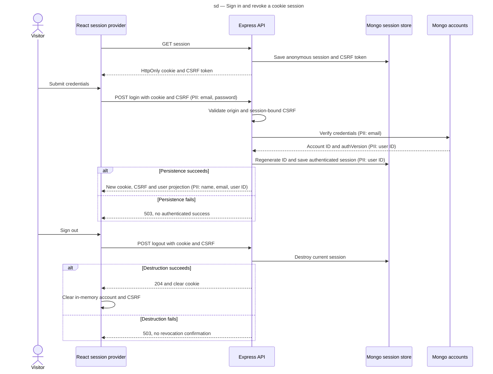

# Sequence diagram — cookie sessions

Source: [validated specification](../../specs/cookie-sessions.md), UC1–UC3 and D5–D9.

> Decision: [ADR-0001](../../decisions/0001-server-managed-cookie-sessions.md).

## Context

This view makes regeneration, persistence-before-success, and server logout explicit.
It is a visual index of the validated HTTP contract.

## Diagram

## Notes

- Cookies and CSRF tokens are sensitive on every protocol exchange.
- Invalid credentials and rejected CSRF stop before creating authenticated state.
- Replay and concurrency behavior require integration tests under R9.
