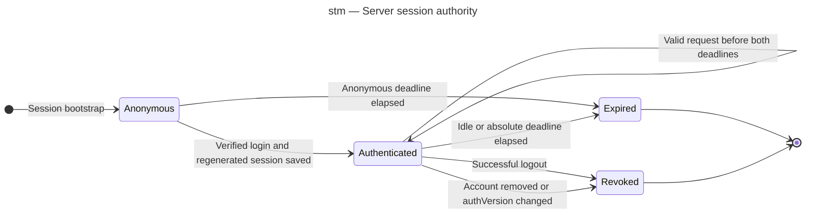

# State diagram — cookie sessions

Source: [validated specification](../../specs/cookie-sessions.md), D3–D7 and R3/R5.

> Decision: [ADR-0001](../../decisions/0001-server-managed-cookie-sessions.md).

## Context

Authentication expiry is enforced during request handling independently of Mongo cleanup.
This view concerns server authority, not the React loading state.

## Diagram

## Notes

- stm — Server session authority.
- Role changes are loaded from the current account and do not require a cached-role update.
- A new login creates a new identifier, never revives expired or revoked authority.
- Store unavailability is a request failure, not an authority-granting transition.
