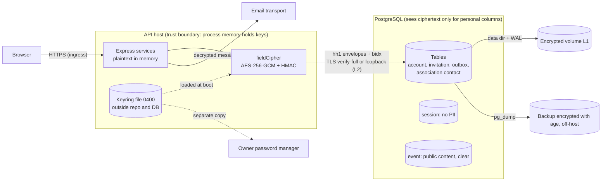

# Data-flow diagram — db-encryption — Where personal data is clear or encrypted

> **Source spec**: [encryption at rest](../../specs/db-encryption-at-rest.md) § 2–3, § 9
> **Related**: [V1 data flow 06](../v1-events/06-data-flow.md)

Status: proposed, awaiting Benoît's validation.

Question answered: at which trust boundary is each personal value clear, and which key protects it?

Notes: the keyring copy and the backups never travel together; T6 (full host compromise) is
outside what this layer protects.
