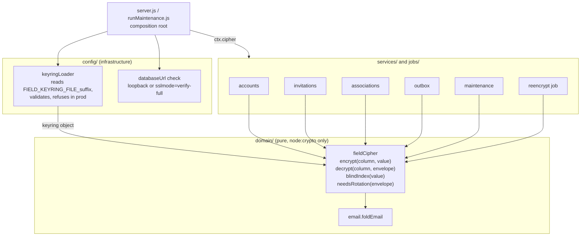

# Component diagram — db-encryption — fieldCipher placement and dependencies

> **Source spec**: [encryption at rest](../../specs/db-encryption-at-rest.md) § 6, § 8

Status: validated by Benoît on 2026-10-23.

Question answered: which module owns encryption, who depends on it, and does the dependency
rule hold (domain never imports infrastructure)?

`fieldCipher` receives the keyring as a value; it reads no file or environment variable, so it
is unit-testable with a throw-away keyring. No repository/ORM layer is added: services already
own their SQL and call the cipher at that boundary (KISS).
