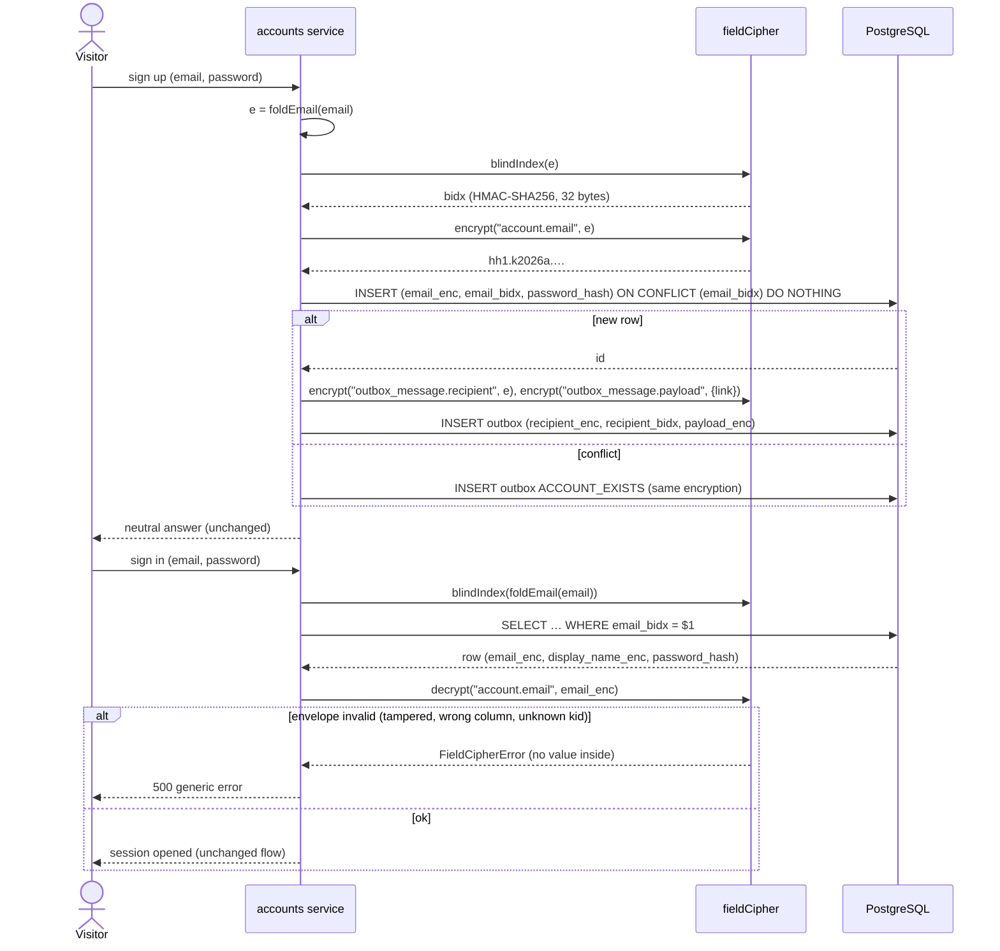

# Sequence diagram — db-encryption — Sign-up and sign-in with a blind index

> **Source spec**: [encryption at rest](../../specs/db-encryption-at-rest.md) § 4–5, § 8

Status: proposed, awaiting Benoît's validation.

Question answered: how do uniqueness and lookup work when the email column is ciphertext?

