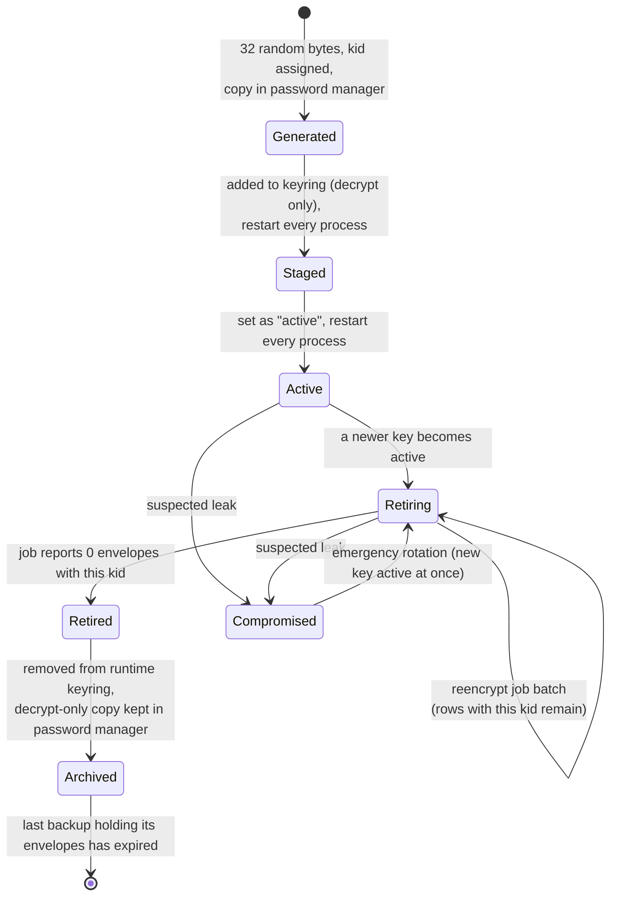

# State diagram — db-encryption — Encryption key lifecycle and rotation

> **Source spec**: [encryption at rest](../../specs/db-encryption-at-rest.md) § 6.2

Status: validated by Benoît on 2026-10-23.

Question answered: when may a key encrypt, decrypt, or be removed?

Rules: only `Active` encrypts; `Staged`, `Active` and `Retiring` decrypt (staging first means no
process meets an envelope whose key it lacks); the archived copy stays until every
backup older than the rotation has expired, so a restore stays readable; removing a key while envelopes
still carry its kid is refused by the job's zero-count check (AC5). The blind-index key follows
its own exceptional procedure (spec § 6.3).
