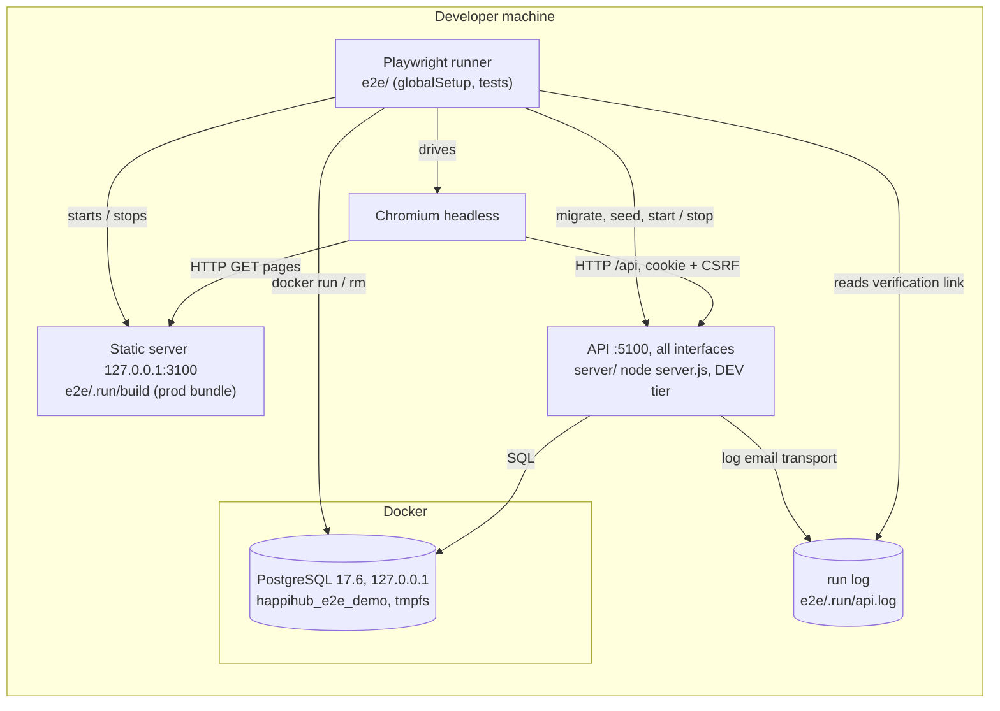

# Deployment diagram — e2e-smoke-tests — what runs during a local gate run

> **Source spec**: [E2E and smoke tests](../../specs/e2e-smoke-tests.md) § 2

Status: validated by Benoît on 2026-11-06.

Question answered: which processes and containers exist during `npm test` in `e2e/`, and who talks to whom?

