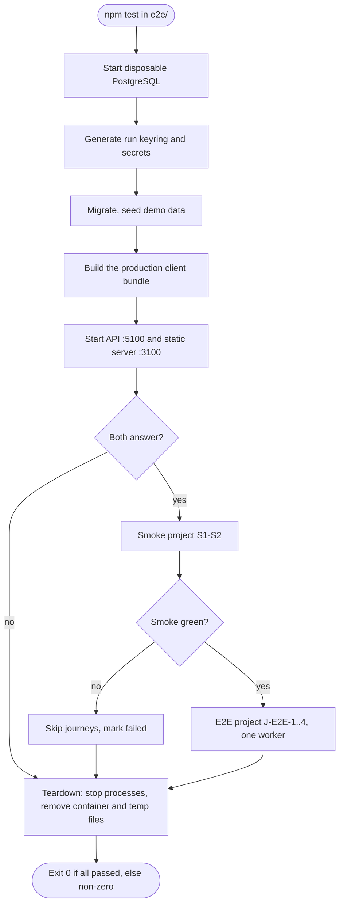

# Activity diagram — e2e-smoke-tests — one gate run

> **Source spec**: [E2E and smoke tests](../../specs/e2e-smoke-tests.md) § 3, § 7, § 10

Status: proposed, awaiting Benoît's validation.

Question answered: in which order does one run prepare, test and clean up, and where does it stop?

