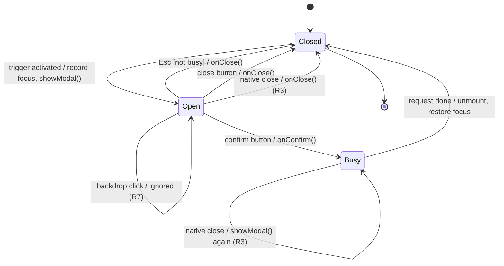

# State — modal confirmation dialog lifecycle (#346)

Spec: [modal-confirmation-dialog](../../specs/modal-confirmation-dialog.md), rules R1–R4, R7.

On every transition to `Closed` the dialog is unmounted and focus returns to the recorded
trigger (R4).
