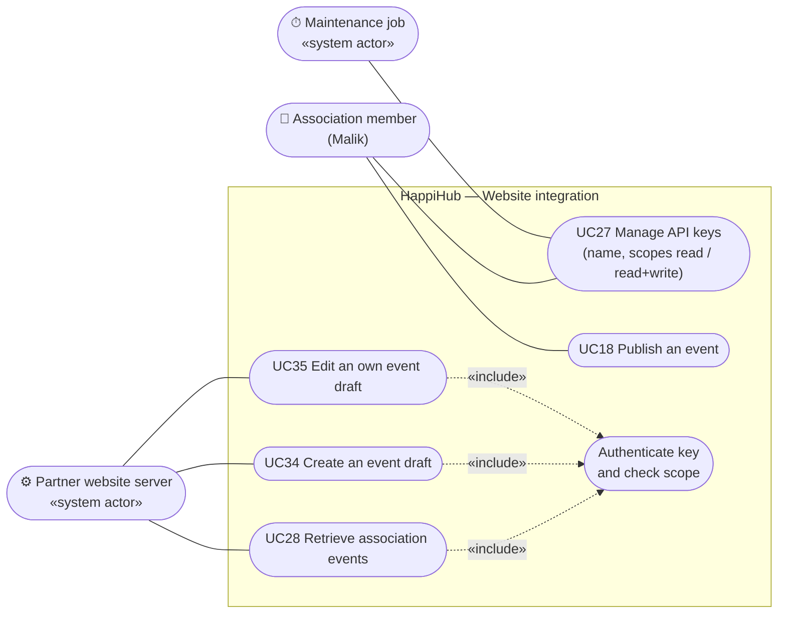

# Use case diagram — partner-api — Website integration with scoped keys

> **Source spec**: [partner API](../../specs/partner-api.md) § 2, § 8

Status: proposed, awaiting Benoît's validation.

Question answered: what can a partner site do with a key, and which actions stay with members?

## Notes

- The maintenance job takes part in UC27 only for automatic revocation (I1).
- UC18 is the unchanged member publication: a partner never publishes (D0). It appears here
  because it ends every UC34 flow.
- No use case lets a key manage keys, members, or cancel and delete events (threat T8).
