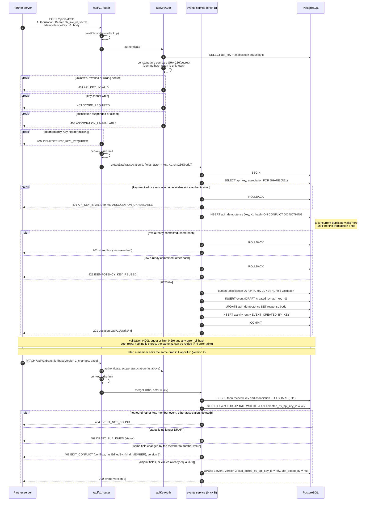

# Sequence diagram — partner-api — Create a draft with idempotency, then edit it

> **Source spec**: [partner API](../../specs/partner-api.md) § 4, UC34, UC35

Status: validated by Benoît on 2026-10-24 (review-local corrections M1–M3 included).

Question answered: how does a retried creation stay single, and how do key and member edits meet?

## Notes

- Writing the idempotency row in the event transaction (M1) means no "in progress" state exists:
  a crash before commit leaves nothing, a crash after commit leaves a replayable 201.
- `lastUsedAt` update (at most hourly) is omitted for readability (see v1 02c).
