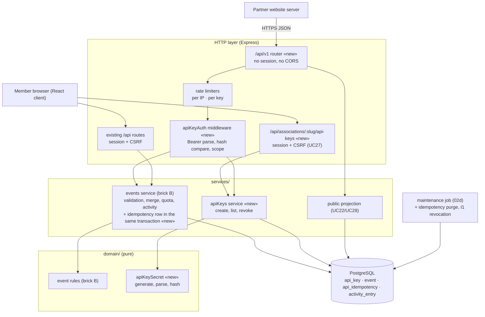

# Component diagram — partner-api — Where the partner API sits

> **Source spec**: [partner API](../../specs/partner-api.md) § 4, § 10

Status: validated by Benoît on 2026-10-24.

Question answered: which modules are new, what do they reuse, and does the dependency rule hold?

## Notes

- The write path reuses the brick B events service with an actor that is either a member or a
  key: one validation and merge implementation (DRY), no partner-specific copy.
- `domain/` stays free of Express and `pg` (dependency rule). Key secrets use `node:crypto` only.
- Key management lives on the session side so a key can never manage keys (threat T8).
