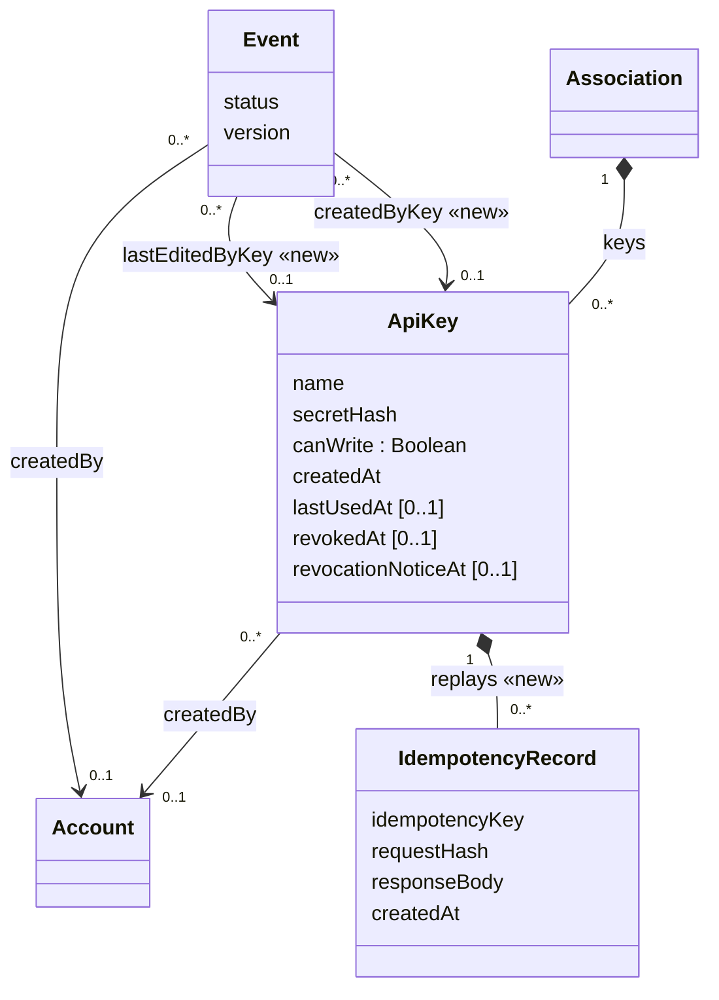

# Class diagram — partner-api — Data delta on the V1 model

> **Source spec**: [partner API](../../specs/partner-api.md) § 5
> **Base**: [v1 class diagram](../v1-events/04-class.md) (`ApiKey`, `Event`, `ActivityEntry`)

Status: validated by Benoît on 2026-10-24.

Question answered: which attributes and associations are added for scopes, key attribution and
idempotency?

## Constraints

- At most 5 keys per association have `revokedAt` null (UC27 1a); revoked keys are kept (R5).
- Every key reads; `canWrite` adds `events:write`, fixed at creation (R1). The API shows it as `scopes`.
- An event has at most one of `createdBy` / `createdByKey`, and at most one of
  `lastEditedBy` / `lastEditedByKey` (R4).
- A key edits an event through `createdByKey` only while it is a `DRAFT` (D4, R6).
- `IdempotencyRecord` is written with its event in one transaction and lives 24 h (§ 4).
