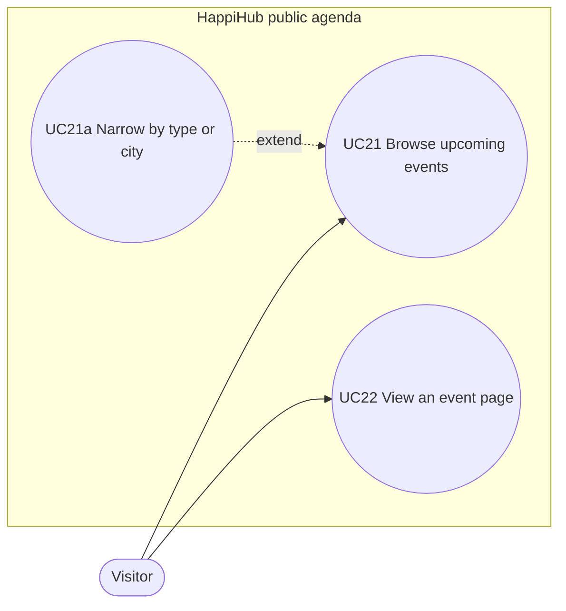

# Use case diagram — public-agenda — what a visitor does without an account

> **Source spec**: [public agenda](../../specs/public-agenda.md) § 2

Status: validated by Benoît on 2026-10-26.

A signed-in account is a visitor too for these goals; no use case needs a session.
