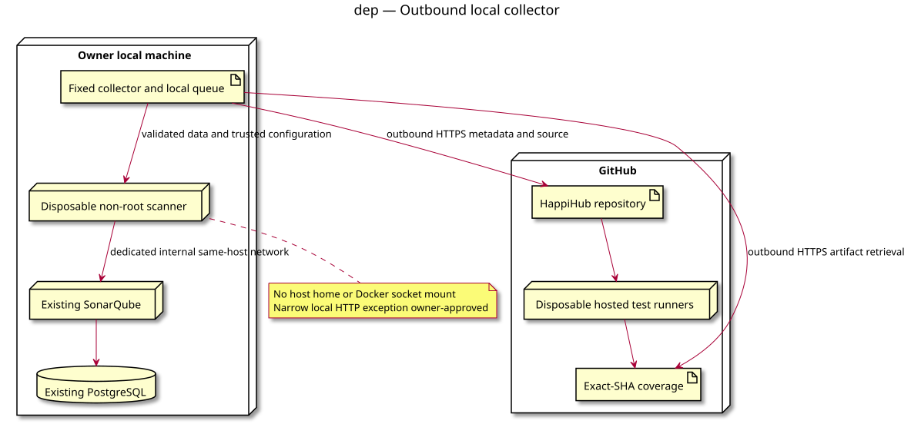

# 03 deployment — Local SonarQube collector

Status: owner-approved conception, 2026-10-13.
Source: [collector conception](../../specs/sonarqube-local-collector.md).

The dedicated same-host internal network and narrow HTTP exception are approved.
Credentials and runtime activation follow the source specification.
