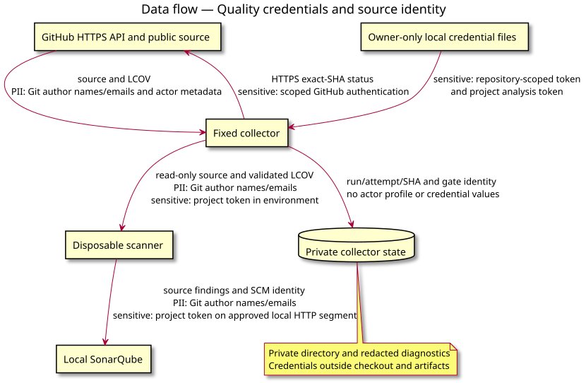

# 05 data flow — Local collector

Status: clarification of the owner-approved algorithm, no new behavior.
Source: [collector conception](../../specs/sonarqube-local-collector.md).

This is a complementary data-flow view, not a native UML diagram. Credential and public SCM identity boundaries are explicit.
