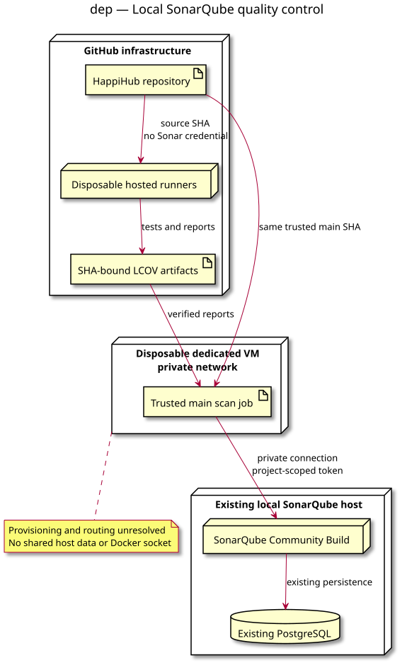

# 03 deployment — SonarQube push analysis

Status: proposed conception, not approved implementation.
Source: [integration specification](../../specs/sonarqube-push-analysis.md).

The specification defines scope, prerequisites and failure guarantees.
