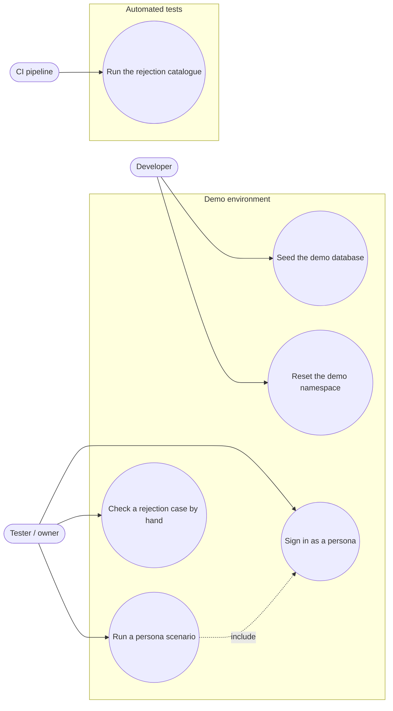

# Use case diagram — test-environment — who uses the demo environment

> **Source spec**: [test environment](../../specs/test-environment.md) § 1, § 3

Status: validated by Benoît on 2026-10-24.

Question answered: which actor-initiated goals does the test environment serve?

Use cases are goals of the actor who starts them; the seed guard and encryption are
system behaviour inside UC1, not use cases.
