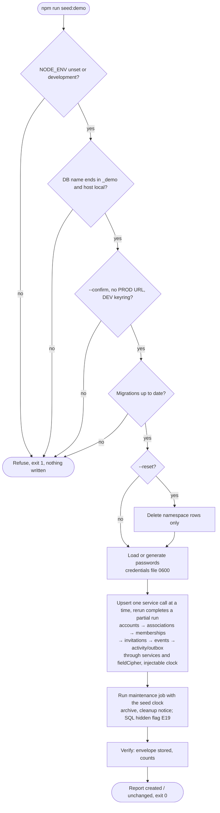

# Activity diagram — test-environment — one seed run

> **Source spec**: [test environment](../../specs/test-environment.md) § 2, § 6–8

Status: validated by Benoît on 2026-10-24.

Question answered: in which order does a run check, write and report, and where does it stop?

