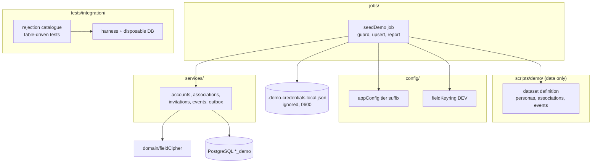

# Component diagram — test-environment — seed placement and dependencies

> **Source spec**: [test environment](../../specs/test-environment.md) § 2, § 7, § 9

Status: validated by Benoît on 2026-10-24.

Question answered: where does the seed live, what does it reuse, and does the dependency
rule hold?

The seed and the tests share no runtime code path: tests never read the demo dataset or
the demo database.
