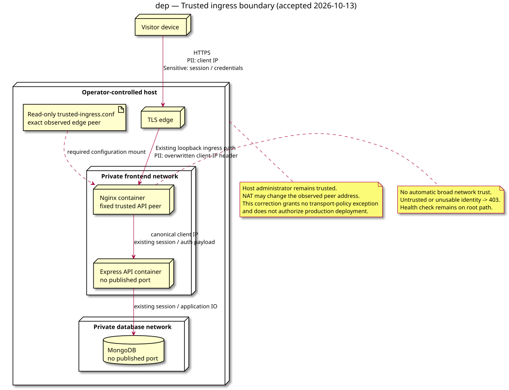

# Deployment — trusted ingress client address

Status: validated by the owner on 2026-10-13. Work item: recovery PR #257 review concern.
Source: [specification](../../specs/trusted-ingress-client-address.md).
Decision: [ADR-0002](../../decisions/0002-normalize-client-address-at-ingress.md).

## Context

This view explains the deployment trust and configuration boundaries.
It refines existing session use cases rather than adding an event feature.

## Diagram

## Notes

- R1-R7 and their tests are authoritative in the specification.
- IP addresses are personal data; credentials/cookies retain existing sensitive handling.
- The diagram does not approve a deployment or additional plaintext internal transport.
- No class/state views are needed: this correction introduces neither entities nor lifecycle.
