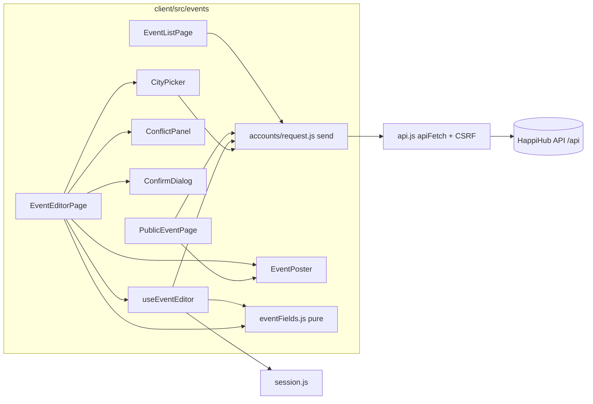

# Component diagram — v1-event-client

> **Source spec**: [client event workflow](../../specs/v1-brick-b-client-event-workflow.md) § 5

Status: validated by Benoît on 2026-10-22.

`eventFields.js` has no imports; screens never call `apiFetch` directly.
