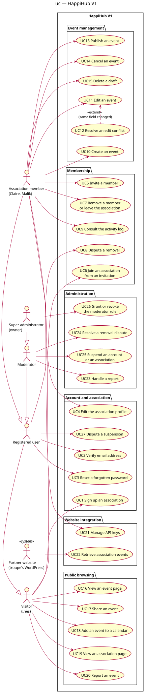

# Use case diagram — v1-events — HappiHub V1 scope

> **Feature**: epic #41 — HappiHub V1 conception package
> **Source specs**: [V1 product framing](../../specs/v1-product-framing.md),
> [V1 personas](../../specs/v1-personas.md), [V1 user journeys](../../specs/v1-user-journeys.md),
> [V1 use cases](../../specs/v1-use-cases.md) (Cockburn fiches)
> **Related ADRs**: ADR-0001 (cookie sessions)

Status: validated by the owner on 2026-10-15 (conception workshop 3).

## Context

Who wants what in V1. One global diagram grouped by domain; each use case is detailed in its
textual fiche. It does not show components, screens or navigation.

## Diagram

Source: [01-use-case.puml](01-use-case.puml).

## Notes

- Actor generalization: Association member → Registered user → Visitor; Super administrator →
  Moderator → Registered user. The super administrator alone grants or revokes the moderator
  role (UC33); a moderator handles reports, removal disputes and suspensions (UC29–UC31),
  never appoints anyone. Suspensions are logged, notified and disputable (UC9). Each actor is linked
  only to its own goals; UC1 and UC11 start before the person is a member, UC13 after removal.
- Sign-in is not a use case (Cockburn subfunction); it is the "authenticated" precondition,
  specified by ADR-0001.
- Automatic archiving is a system event, not a use case; it belongs to the event state diagram.
- Verified email is a precondition of UC10 and UC18, not an «include».
- Only one relationship: UC17 «extend» UC16 when the same field changed concurrently (J4 D2).
- Joint review 2026-10-15 (owner + Claude), every option scored and confronted:
  - F1 UC6 Delete my account (GDPR); F8 as last member it closes the association in the same
    flow with an explicit warning (4.9 vs blocked 4.1).
  - F3/F10 every moderation decision (hidden event, suspension) is disputable (UC9) and only the
    super administrator resolves it (UC32) (4.5 vs another moderator 3.6). Known limit: a
    decision taken by the super administrator acting as moderator has no independent review.
  - F2 UC8 only the last member closes the association (4.5 vs any member 3.8): upcoming events
    cancelled, API keys revoked, page and slug frozen 30 days then deleted.
  - F16 UC21 chronological public agenda of upcoming events, filterable by city, no ranking (4.2
    vs no agenda 3.5).
  - F11 UC5 self-service JSON data export (4.8 vs manual request 3.5).
  - F4 UC10 renamed Manage invitations (invite, revoke); F5 UC4 Update my account; F6 UC26 also
    covers associations.
  - Known limit F14: a single super administrator (no succession). V2: duplicate an event (#255).
