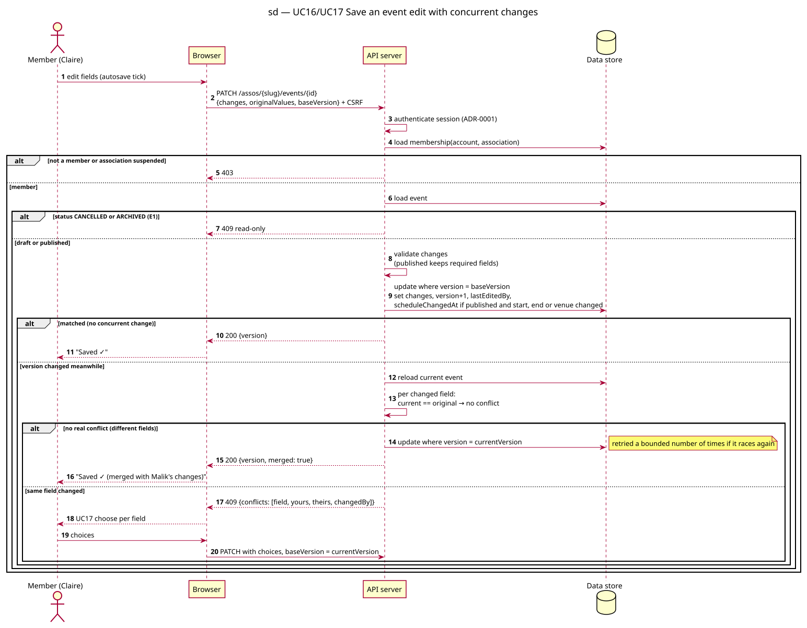

# Sequence diagram — v1-events — Save an event edit with concurrent changes

> **Feature**: epic #41 — HappiHub V1 conception package
> **Source specs**: [V1 use cases](../../specs/v1-use-cases.md) UC16, UC17
> **Related**: [class diagram](04-class.md), ADR-0001 (sessions, CSRF)

Status: proposed (conception workshop 4); decisions Q1 and Q2 validated by the owner on 2026-10-15, diagram pending owner review.

## Context

Every save, autosave included, is a conditional write on the event version. Not covered: creation of the first draft (plain insert).

## Diagram

Source: [02a-sequence-autosave-conflict.puml](02a-sequence-autosave-conflict.puml).

## Notes

- Q1 (validated, 4.6 vs browser-side merge 2.8): the server merges field by field. A field conflicts only when its current value differs from the original value the browser loaded, so concurrent edits of different fields merge silently (J4 D2).
- The conditional write makes check-and-update atomic; the merge retry is bounded.
- `scheduleChangedAt` is set in the same write when a published event's start, end or venue changes (J3 D1).
