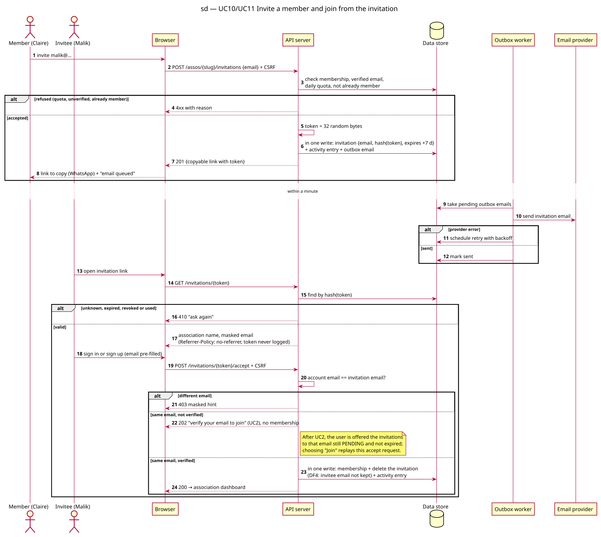

# Sequence diagram — v1-events — Invite a member and join from the invitation

> **Feature**: epic #41 — HappiHub V1 conception package
> **Source specs**: [V1 use cases](../../specs/v1-use-cases.md) UC10, UC11
> **Related**: [class diagram](04-class.md), ADR-0001 (sessions, CSRF)

Status: validated by the owner on 2026-10-15 (conception workshop 4).

## Context

Invitation creation, email delivery through the outbox, and acceptance bound to the invited email.

## Diagram

Source: [02b-sequence-invite-and-join.puml](02b-sequence-invite-and-join.puml).

## Notes

- Q2 (validated, 4.1 vs direct send 4.0, narrow margin): emails are written to an outbox in the same write as the action and sent by a worker every minute with retries; the copyable link works even before the email leaves.
- Only the token hash is stored; tokens are 32 random bytes, single use, 7 days (J4 D1).
- A newly created account stays unverified (UC11 extension 3a).
