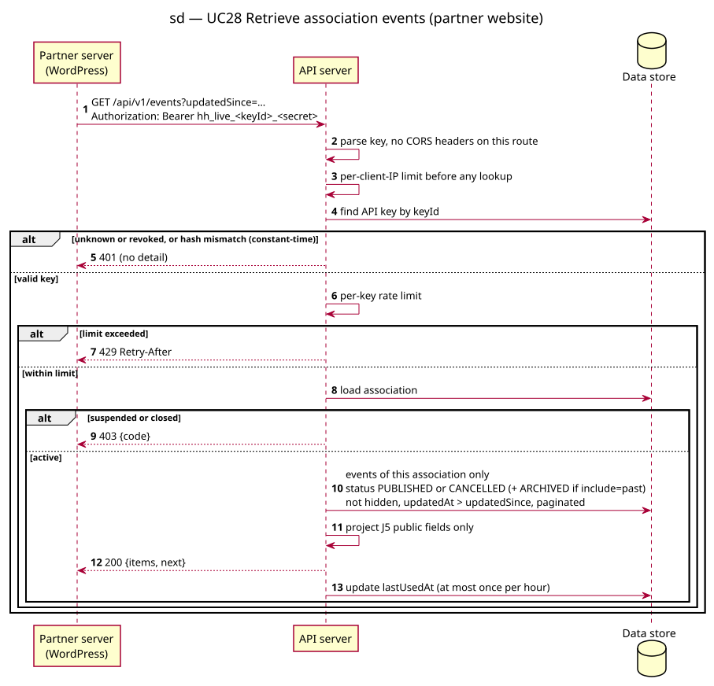

# Sequence diagram — v1-events — Retrieve association events

> **Feature**: epic #41 — HappiHub V1 conception package
> **Source specs**: [V1 use cases](../../specs/v1-use-cases.md) UC28, UC27
> **Related**: [class diagram](04-class.md), ADR-0001 (sessions, CSRF)

Status: validated by the owner on 2026-10-15 (conception workshop 4).

## Context

Server-to-server read by a partner website with an association API key.

## Diagram

Source: [02c-sequence-api-retrieve-events.puml](02c-sequence-api-retrieve-events.puml).

## Notes

- Keys look like `hh_live_<keyId>_<secret>`: lookup by id, constant-time hash comparison. A high-entropy secret only needs a fast hash (SHA-256), unlike passwords.
- `lastUsedAt` is written at most once per hour to avoid a write per request; precise enough for S2 and the 180-day rule (I1).
- Rate limiting is per key and in memory, valid for the single API instance mandated today.
- 404 for other associations' or draft events: no existence leak.
