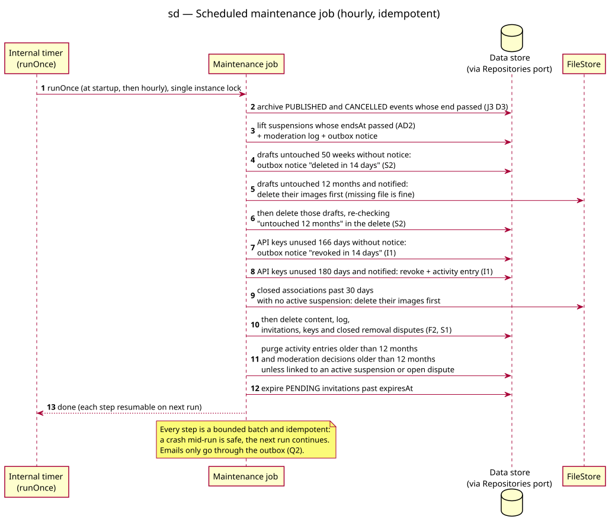

# Sequence diagram — v1-events — Scheduled maintenance job

> **Feature**: epic #41 — HappiHub V1 conception package
> **Source specs**: [V1 use cases](../../specs/v1-use-cases.md) UC8, UC20, UC27, UC31; J3 D3
> **Related**: [class diagram](04-class.md), ADR-0001 (sessions, CSRF)

Status: validated by the owner on 2026-10-15 (conception workshop 4).

## Context

The one hourly job behind every time-based rule. Emails go through the outbox (Q2).

## Diagram

Source: [02d-sequence-scheduled-job.puml](02d-sequence-scheduled-job.puml).

## Notes

- Rules: archiving (J3 D3), suspension end (AD2), draft cleanup with notice (S2), dormant key revocation with notice (I1), closed association deletion only without active suspension (F2, S1), 12-month log purge (J4 D4), invitation expiry.
- Idempotent bounded batches under a single-instance lock: a crash is safe and the next run resumes.
- Archived visibility does not wait for the job: public reads also compare the end date, so an event never shows as upcoming once it has ended.
