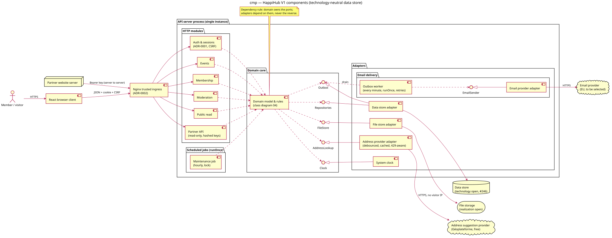

# Component diagram — v1-events — runtime components and boundaries

> **Feature**: epic #41 — HappiHub V1 conception package
> **Source specs**: [V1 product framing](../../specs/v1-product-framing.md), [V1 use cases](../../specs/v1-use-cases.md)
> **Related**: [class diagram](04-class.md), [scheduled job](02d-sequence-scheduled-job.md),
> [partner API](02c-sequence-api-retrieve-events.md),
> [ADR-0001](../../decisions/0001-server-managed-cookie-sessions.md) (sessions),
> [ADR-0002](../../decisions/0002-normalize-client-address-at-ingress.md) (ingress)

Status: validated by the owner on 2026-10-15 (conception workshop 5).

## Context

Runtime components of V1, their interfaces and dependency directions. It does not fix the
database technology (#246), the hosting, the file storage realization or the email provider.

## Diagram

Source: [03-component.puml](03-component.puml).

## Notes

- Browsers and partner servers reach the API only through the TLS edge and the Nginx
  trusted ingress, which forwards one normalized client address (ADR-0002). Browser writes carry the session cookie and CSRF token (ADR-0001); partner
  calls carry a bearer key, get no CORS headers and are read-only (UC28).
- HTTP modules depend on the domain core. The domain core owns the ports; adapters
  implement them (dependency rule). Only real boundaries get a port.
- Sessions live in the data store through the session store adapter (ADR-0001); they stay
  outside the domain model.
- Per-client-IP limits apply on sign-in/sign-up and before any partner key lookup, then
  per-key limits (02c).
- The outbox (email decision Q2, see the [V1 use cases](../../specs/v1-use-cases.md)) is
  written in the same data store as domain changes and drained every
  minute by the outbox worker through `EmailSender`, with retries.
- Domain ports: `Repositories`, `Outbox`, `AddressLookup`, `FileStore`, `Clock`. The outbox
  worker, `EmailSender` and the provider adapter form the "Email delivery" infrastructure
  package; the domain only knows `Outbox`.
- Single API instance today: process-local rate limits (ADR-0001 consequences) and the job
  lock ([02d](02d-sequence-scheduled-job.md)) hold only for one instance.

## Use case ↔ HTTP module (T3, #247)

| Module | Use cases |
| --- | --- |
| Auth & sessions | UC1–UC6 (sign-up, verification, reset, account, export, deletion) |
| Membership | UC7, UC8, UC10–UC12, UC14, UC27 (association profile, closure, members, log, API keys) |
| Events | UC15–UC20 (address proxy CP2 included) |
| Public read | UC21, UC22, UC24, UC25 (UC23 is client-only) |
| Moderation | UC9, UC13, UC26, UC29–UC33 |
| Partner API | UC28 |
| Maintenance job | time rules of UC2, UC8, UC20, UC27, UC31, J3 D3, DF1–DF5 |

## Decisions (2026-10-15)

Scored and confronted; the owner chose after a deeper analysis.

| # | Decision | Kept (score) | Rejected (score) |
| --- | --- | --- | --- |
| CP1 | Where the outbox worker and maintenance job run | Inside the API process, triggered by internal timers; each job exposes `runOnce()` so a separate process or external scheduler can trigger it later without domain change; run once at startup, then on schedule (4.6) | Separate worker process (3.9, doubles deployment for one instance); external cron calling an endpoint (3.15, exposes a privileged endpoint; to revisit if the chosen host sleeps when idle) |
| CP2 | How address suggestions are reached | Server proxy: authenticated endpoint, debounced client, small cache, 429 handling; the provider (Géoplateforme geocoding, free, French public service) never sees member IP addresses; CSP `connect-src 'self'` (4.4) | Direct browser calls (3.3, leaks IP and keystrokes to a third party, widens CSP, couples the client to a provider that already changed URL once) |
| CP3 | Where images live | Neutral `FileStore` port, realization (local disk or EU object storage) chosen with hosting; the maintenance job deletes images through it (4.75) | Images in the data store (3.1, prejudges #246, bloats storage and backups) |
| CP4 | API core structure | Domain modules plus ports at real boundaries only; `Clock` is a port so time rules (50 weeks, 166 days, 12 months) are testable deterministically (4.6) | Full hexagonal layering per module (3.95, empty layers for V1); flat without ports (3.05, domain depends on infrastructure) |
| CP5 | Seam between the outbox worker and the email provider | `EmailSender` interface inside the Email delivery infrastructure package, so retry/backoff logic is testable with a fake sender (4.75) | `EmailSender` as a domain port (4.1, puts a concept the domain never uses in the core); worker calls the adapter directly (3.6, retry logic testable only against the real provider) |

Open risks: the shared server IP carries the provider's per-IP quota for all members
(acceptable at V1 scale with debounce and cache); the official Géoplateforme autocompletion
quota is still to confirm before implementation.
