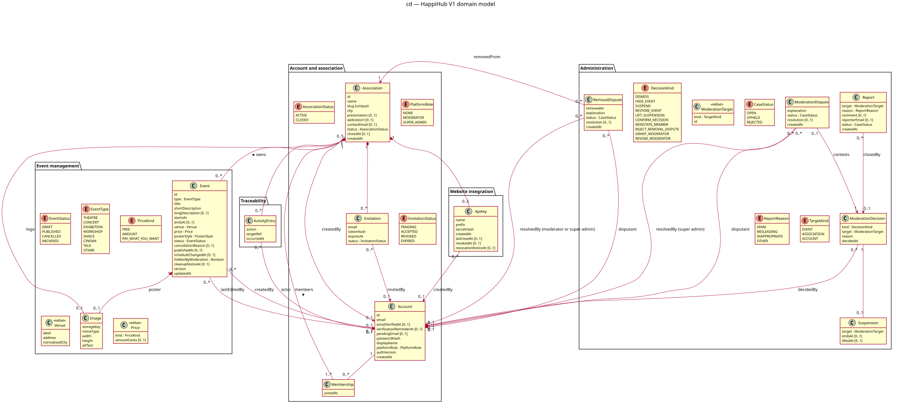

# Class diagram — v1-events — domain model

> **Feature**: epic #41 — HappiHub V1 conception package
> **Source specs**: [V1 use cases](../../specs/v1-use-cases.md), [V1 user journeys](../../specs/v1-user-journeys.md),
> [V1 product framing](../../specs/v1-product-framing.md)
> **Related ADRs**: ADR-0001 (sessions stay outside the domain model)

Status: validated by the owner on 2026-10-15 (conception workshop 4).

## Context

Domain entities, value objects and their relationships for the 33 V1 use cases. It does not
fix the database technology (#246), indexes, API payloads or sessions.

## Diagram

Source: [04-class.puml](04-class.puml).

## Notes

- `Account.platformRole` is an attribute (NONE, MODERATOR, SUPER_ADMIN): one delegable role
  does not justify a role entity. Invariant: at least one SUPER_ADMIN.
- `Membership` is the many-to-many link of M1; an association has at least one member; an
  account creates at most 5 associations.
- `Event.hiddenByModeration` is a flag, not a lifecycle state, so restoring returns the event
  to its previous state (UC29). `version` supports optimistic concurrency (J4 D2);
  `scheduleChangedAt` drives "Updated on" (J3 D1). Lifecycle: see the state diagram.
- `Image.altText` added for WCAG (S7). An event shows either its image or its `posterStyle`.
- `ModerationDecision` is the moderation log; `ActivityEntry` is the association log
  (12 months, no IP address, actor shown as "former member" after deletion).
- `ApiKey.secretHash` only; the secret is shown once (J6 D2). At most 5 keys per association.
- Decisions (validated 2026-10-15, scored and confronted):
  - C1 Venue is a value copied into each event, with suggestions from the association's past
    venues (4.4). Rejected: shared venue by reference (3.6, editing rewrites past events).
  - C2 Two dispute classes: `RemovalDispute` (resolved by a moderator) and
    `ModerationDispute` (contests a `ModerationDecision`, resolved by the super administrator)
    (4.5). Rejected: one class with a kind (3.5, hides two processes behind conditions).
  - C3 `ModerationTarget` value object {kind, id} shared by Report, ModerationDecision and
    Suspension (4.3). Rejected: three optional references with exclusivity rules (3.6).

## Review — class and sequence diagrams (2026-10-15)

The owner asked Claude to review, confront the alternatives and keep only the highest-scored
option for each finding. Applied:

| # | Finding | Kept (score) | Rejected (score) |
| --- | --- | --- | --- |
| K7 | `createdBy`, `lastEditedBy`, `invitedBy`, `decidedBy` were mandatory, contradicting immediate account deletion (A5) | Multiplicity 0..1, shown as "former member" (4.8) | Keep a tombstone account (3.4, retains personal data); forbid deletion with authored content (2.0, breaks GDPR) |
| K12 | No place for an email change awaiting verification (UC4) | `Account.pendingEmail` (4.6) | Separate change-request entity (3.6, one field suffices) |
| K9 | Notices before automatic deletion/revocation (S2, I1) not traceable | `Event.cleanupNoticeAt`, `ApiKey.revocationNoticeAt` (4.5) | Derive from outbox history (3.2, couples domain to delivery) |
| K4 | Report and dispute statuses untyped | Shared `CaseStatus` OPEN/UPHELD/REJECTED (4.4) | Free text (2.5) |
| K5 | `EventType`, `PriceKind`, `ReportReason` undeclared | Declared enums aligned with J2 and P1 (4.5) | Leave implicit (3.0) |
| K11 | A removal dispute may be escalated (conflict of interest) | Resolver "moderator or super admin" (4.6) | Moderator only (3.0, contradicts the escalation rule) |
| K6 | Email outbox (Q2) absent from the model | Kept out: infrastructure, not domain (dependency rule) (4.7) | Domain class (3.1) |
| SQ1 | Editing a published event could move its start to the past | Edit validation also enforces a future start (E2) (4.6) | Allow (3.0, bypasses E2) |
| SQ2 | Invitation token in the URL could leak through Referer or logs | `Referrer-Policy: no-referrer` on that page and tokens never logged (4.5) | Token only in a POST body (3.8, breaks the copyable link of J4 D1) |
| SQ3 | Unauthenticated floods reach the key lookup before the per-key limit | Per-client-IP limit before lookup (4.6) | Per-key limit only (3.4) |
| SQ4 | The 12-month purge could delete a decision still backing an active suspension or open dispute | Purge only unlinked decisions (4.9) | Plain 12-month purge (2.6, broken references) |
| SQ5 | Closed-association deletion left invitations, keys and removal disputes dangling | Delete them with the association (4.6) | Keep orphans (2.4) |
| SQ6 | API key hash | SHA-256 for 256-bit random secrets, lookup by key id, constant-time compare (4.7) | bcrypt (3.6, slow for no gain on high-entropy secrets) |
| SQ7 | `lastUsedAt` write frequency | At most once per hour (4.5) | Every request (3.5, one write per call) |
| DF2 | Reminder before deleting a never-verified account (data-flow diagram, 2026-10-15) | `Account.verificationReminderAt`, K9 precedent (owner revalidated) | Derive from `createdAt` (not idempotent) |
| DF4 | Invitations no longer pending hold a third-party email | Deleted once accepted, revoked or expired; `InvitationStatus` only names the transition (data-flow DF4) | Keep them 12 months (390 vs 395) |
| SQ8 | Past events shown as upcoming until the hourly job runs | Public reads also compare the end date (4.6) | Rely on the job only (3.4, up to one hour stale) |

Final review #247 (2026-10-15, owner validated the top MCDA scores):

| # | Finding | Kept (score /500) | Rejected (score) |
| --- | --- | --- | --- |
| T1 | UC30, UC31 3a, UC32 and UC33 must be logged but `DecisionKind` had no value for them | Extend `DecisionKind` (RESTORE_EVENT, LIFT_SUSPENSION, CONFIRM_DECISION, REINSTATE_MEMBER, REJECT_REMOVAL_DISPUTE, GRANT_MODERATOR, REVOKE_MODERATOR); `ModerationTarget` ACCOUNT carries role changes; `decidedBy` absent only for LIFT_SUSPENSION by the maintenance job, otherwise shown as "former member" after deletion; GRANT_MODERATOR and REVOKE_MODERATOR always target an ACCOUNT (430) | Separate `PlatformAuditEntry` class (385); technical logs only (345) |
| T5 | No way to create the first SUPER_ADMIN | Operator bootstrap: a one-off server command run by the owner at deployment promotes one verified account; refused if a SUPER_ADMIN exists; not a use case | — |

On account deletion, the user's own disputes are deleted with the account (GDPR); moderation
decisions keep their target reference.
