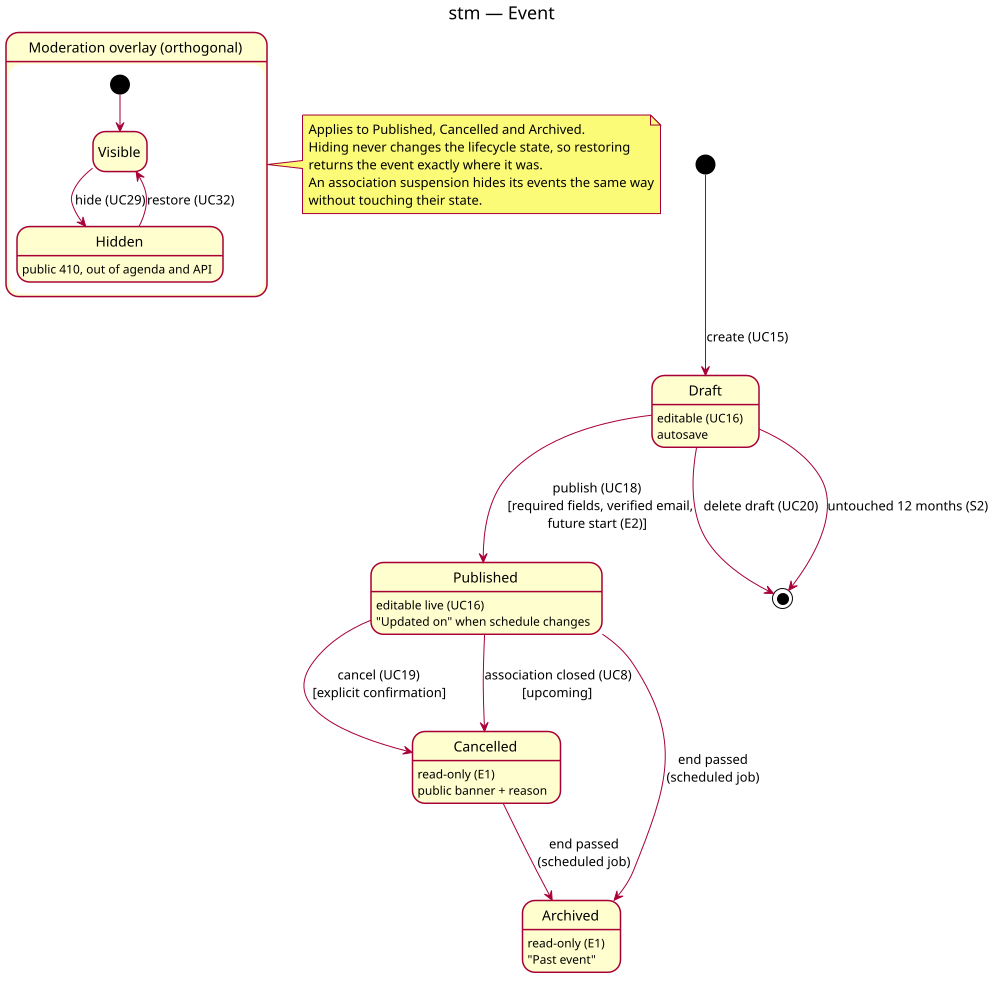

# State diagram — v1-events — Event

> **Feature**: epic #41 — HappiHub V1 conception package
> **Source specs**: [V1 use cases](../../specs/v1-use-cases.md) UC15–UC20, UC8, UC29, UC32;
> [V1 user journeys](../../specs/v1-user-journeys.md) J3
> **Class**: `Event.status`, `Event.hiddenByModeration` in [04-class](04-class.md)

Status: validated by the owner on 2026-10-15 (conception workshop 4).

## Context

Lifecycle of an event and the orthogonal moderation overlay. Automatic transitions are run
by one scheduled job (archiving, draft cleanup).

## Diagram

Source: [05a-state-event.puml](05a-state-event.puml).

## Notes

- Publication guard: required fields, verified email, future start (E2). Cancelled and
  archived are read-only (E1). Only drafts are deleted.
- Hiding (UC29) and restoring (UC32) never change the lifecycle state; an association
  suspension hides its events the same way.
- T9 (#247): the suspension effect is derived at read time from the active `Suspension`; it never sets `hiddenByModeration`, so lifting it cannot reveal an event hidden by a report.
- S2 (validated, 4.2 vs keep forever 3.8): a draft untouched for 12 months is deleted after a
  14-day email notice to members, same mechanism as API keys (I1).
- Brick B (2026-10-16, [spec](../../specs/v1-brick-b-event-lifecycle.md) A1): an event without an end date counts as ended 24 h after its start, for archiving and public "past" checks.
- Brick B (UC8 closure): drafts of a closing association are deleted; upcoming published events are cancelled. This transition is not yet drawn in the picture.
- Replaces the legacy pending/approved/rejected moderation; migrating existing events is a
  conception item for the data study (#246).
