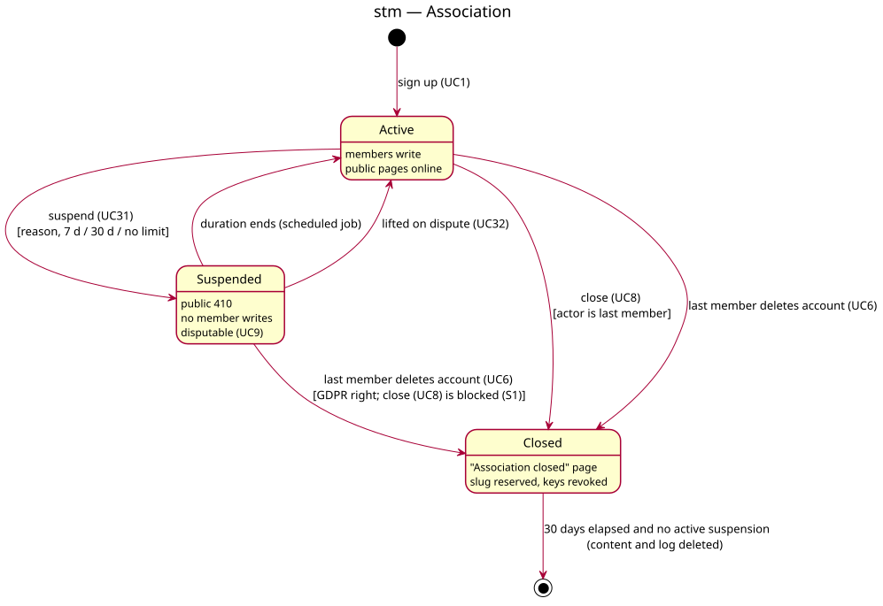

# State diagram — v1-events — Association

> **Feature**: epic #41 — HappiHub V1 conception package
> **Source specs**: [V1 use cases](../../specs/v1-use-cases.md) UC1, UC6, UC8, UC9, UC31, UC32
> **Class**: `Association.status` and active `Suspension` in [04-class](04-class.md)

Status: validated by the owner on 2026-10-15 (conception workshop 4).

## Context

Lifecycle of an association. "Suspended" is derived from an active `Suspension` (not a stored
status value); "Closed" is `Association.status`.

## Diagram

Source: [05b-state-association.puml](05b-state-association.puml).

## Notes

- S1 (validated, 4.5 vs allowed 2.8): closing is blocked while suspended, so a suspended
  spammer cannot erase evidence; members dispute (UC9) or wait for the end of the duration.
- Consequence of S1 with A5: account deletion stays a GDPR right, so a last member may still
  delete their account while suspended; the association is then closed but its content is only
  deleted once no suspension is active and 30 days have elapsed.
- Closing cancels upcoming events, revokes API keys and reserves the slug for 30 days (F2).
