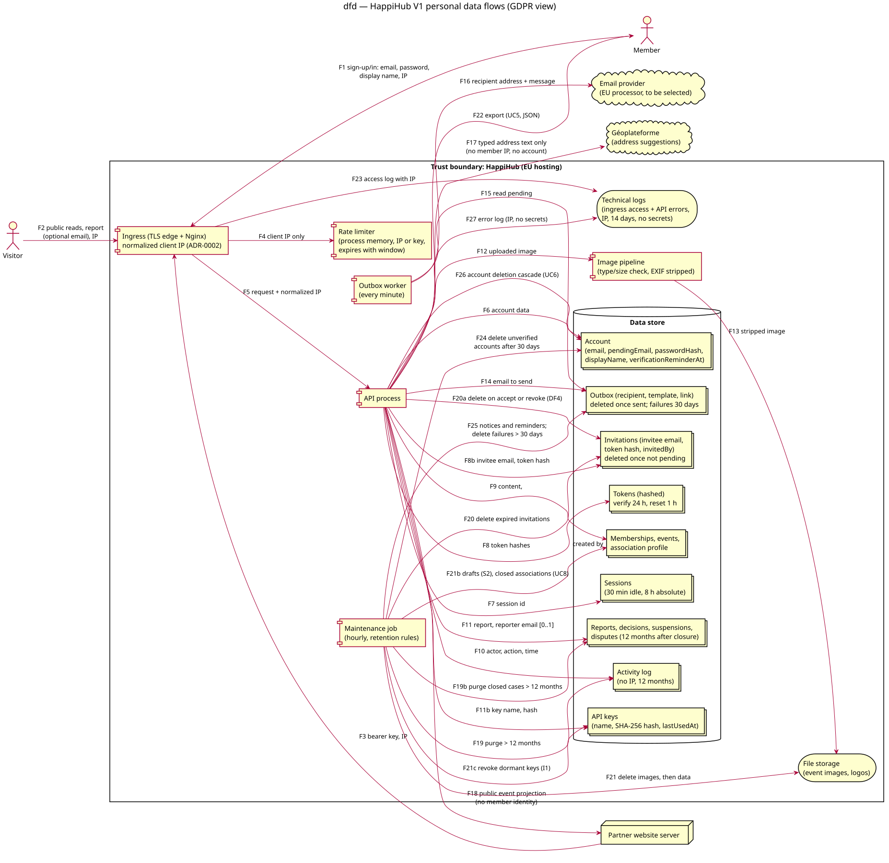

# Data-flow diagram — v1-events — personal data, legal basis and retention

> **Feature**: epic #41 — HappiHub V1 conception package
> **Source specs**: [V1 product framing](../../specs/v1-product-framing.md) (EU hosting, GDPR),
> [V1 use cases](../../specs/v1-use-cases.md) UC1–UC14, UC20, UC22–UC33;
> decisions A5, I1, S2, J4 D1–D4
> **Related**: [component diagram](03-component.md), [class diagram](04-class.md),
> [scheduled job](02d-sequence-scheduled-job.md), [invite and join](02b-sequence-invite-and-join.md),
> [ADR-0001](../../decisions/0001-server-managed-cookie-sessions.md) (sessions),
> [ADR-0002](../../decisions/0002-normalize-client-address-at-ingress.md) (ingress)

Status: validated by the owner on 2026-10-15 (conception workshop 6), DF4–DF5 and the
local-review fixes included. Amendment for the frozen D3 tables and pseudonymous moderation
references proposed by [brick D](../../specs/v1-brick-d-accounts-associations.md) § 10,
approved by the owner on 2026-10-16.

## Context

Where personal data enters, is stored, leaves HappiHub and is erased. It does not fix the
database technology (#246), the hosting, the email provider or backups (decided with hosting).

## Diagram

Source: [06-data-flow.puml](06-data-flow.puml).

## Personal data inventory

| Data | Purpose | Legal basis (GDPR art. 6) | Retention |
| --- | --- | --- | --- |
| Account: email, `pendingEmail`, password hash, display name | Sign-in, notifications, attribution | Contract (6.1.b) | Until account deletion (A5, immediate); never verified: 30 days, reminder at day 23 (DF2) |
| Sessions (ADR-0001) | Authentication | Contract | 30 min idle, 8 h absolute; revoked on account deletion, password change or reset, account suspension; removal from an association ends access to that association at once through the per-request membership check, without revoking sessions (M1, T6). Security invariant: every association-scoped request re-checks membership; membership is never cached in the session |
| Verification and reset tokens (hash only) | Prove email ownership | Contract | 24 h / 1 h, single use |
| Invitation: invitee email, token hash, `invitedBy` | Invite a third party (UC10) | Legitimate interest (6.1.f) of the association | 7 days at most; deleted as soon as accepted, revoked or expired, the activity log keeping the action (DF4) |
| Memberships, events, association profile, `createdBy`, `lastEditedBy` | Organize and publish events | Contract (members); legitimate interest for attribution | Life of the association; closed association: 30 days then deleted (UC8); drafts untouched 12 months deleted after a 14-day notice (S2) |
| Association contact email | Public contact | Legitimate interest; generic address advised | Until edited or association deleted |
| Activity log (actor, action, target; no IP) | Accountability inside the association | Legitimate interest | 12 months |
| Reports (free-text comment, optional reporter email), moderation decisions (`decidedBy`, reason), suspensions, disputes (`disputant`, `resolvedBy`, explanation) | Moderation and its accountability | Legitimate interest | 12 months after the case closes or the suspension is lifted; still kept while it backs an active suspension, a hidden event or an open dispute (SQ4, DF5); reporter email deleted once the reporter is informed |
| Outbox (recipient, template, link) | Email delivery | Contract (members); legitimate interest (invitees, reporters) | Deleted once sent; definitive failures 30 days (DF1) |
| Client IP — rate limiter | Abuse protection | Legitimate interest | Process memory, expires with the window |
| Client IP — technical logs (ingress access, API errors) | Security incident investigation | Legitimate interest | 14 days (DF3); never an email, password, token or request body |
| API keys: name, SHA-256 hash, `createdBy`, `lastUsedAt` | Partner access requested by members | Contract | Revoked after 180 days unused, 14-day notice (I1); deleted with the association |
| Images and logos (EXIF stripped) | Event presentation | Contract | Deleted with their draft, event or association; images before data (02d) |
| Frozen participation (`event_participation`: event, account) and comments (`event_comment`: event, account, text, date) — D3, F28 | Existing behavior kept, not extended | Contract | Deleted with the event or the account (cascade); never in public projections or the partner API |
| Pseudonymous `target_id` of a deleted account in reports, decisions and suspensions | Moderation accountability | Legitimate interest | Kept after account deletion until DF5 purges the record; no other account data is retained with it |

No consent-based processing exists in V1: no analytics, no third-party script, only strictly
necessary cookies (session, CSRF), so no consent banner.

## Flows leaving HappiHub

- **Email provider** (F16): recipient address and message only; an EU processor under a
  data processing agreement (art. 28), selected with hosting.
- **Géoplateforme** (F17): only the typed address text through the server proxy (CP2); no
  member IP, no account identifier.
- **Partner API** (F18): public event projection; never owner, member or participant
  identifiers.
- **Export** (F22, UC5): the requester's own data as JSON (rights of access and portability),
  including its own participations and comments (D3).

## Account deletion (UC6, A5) and its effects (F26)

Immediate, after the current password and confirmation:

- Deleted: account data, sessions, pending verification/reset tokens, pending invitations
  addressed to its email, own removal and moderation disputes (releasing their SQ4 link),
  pending outbox messages to its address, its participations and comments (D3, cascade).
- Kept with the association, shown as "former member": events (`createdBy`, `lastEditedBy`),
  activity entries, invitations it sent while still pending, API keys it created.
- Kept for moderation accountability, shown as "former member": decisions it took
  (`decidedBy`) and disputes it resolved (`resolvedBy`), until DF5 expires them.
- Kept as a pseudonymous reference: the account's id as `target_id` of reports, decisions and
  suspensions that targeted it (no foreign key, schema study § 3), until DF5 expires them.
- Memberships end; an association left without member is closed (UC8, 30 days then deleted).
- Technical logs expire on their own 14-day cycle; backups follow their rotation (see below).

## Decisions (2026-10-15)

Criteria: GDPR minimization 35, operability 25, simplicity 25, user experience 15.

| # | Decision | Kept (score /500) | Rejected (score) |
| --- | --- | --- | --- |
| DF1 | Outbox retention | Deleted once sent; definitive failures kept 30 days for diagnosis (435) | Everything 30 days (390); 12 months like logs (320) |
| DF2 | Accounts never verified | Deleted after 30 days, reminder at day 23 traced by `Account.verificationReminderAt` (K9 precedent); association content follows UC8 (410) | 12 months inactivity + 14-day notice like drafts (400, wins if minimization weight < 30); kept forever (360) |
| DF3 | IP in technical logs | Ingress access and API error logs with IP, 14 days, legitimate interest (security) (400) | No IP logged (395, wins if operability weight < 20); 30 days (390) |
| DF4 | Invitations no longer pending (third-party email) | Deleted as soon as accepted, revoked or expired; the log keeps the action (395) | Kept 12 months like the log (390, wins if operability weight ≥ 30); email erased 30 days after closure (375) |
| DF5 | Moderation records | 12 months after the case closes or the suspension is lifted, extending SQ4 (400) | 6 months (395, wins if minimization weight > 40); kept indefinitely (330) |

The local review before push (2026-10-15) also corrected: the DF2 wording (association
content is never deleted with an account), the API key basis (contract), the outbox basis,
the API error log flow, the full deletion cascade and the maintenance job flows.

## Out of scope

Backup retention and encryption are decided with hosting; deleted data survives in backups
until their rotation, to be stated in the privacy policy.
