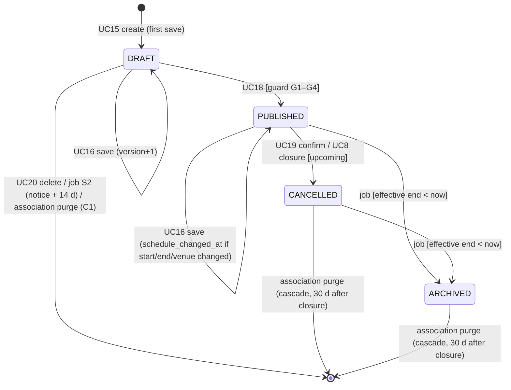

# HappiHub V1 — brick B: event lifecycle and editor backend (UC15–UC20)

Status: **decided by the owner on 2026-10-16** (section 11). Conception approved; implementation
of brick B may start on its own branch, within this specification.

Baseline: `main` @ `4a58b5a`. Inputs: [use cases](v1-use-cases.md) UC15–UC20 (E1, E2, quotas
T2), [data and migration study](v1-data-migration.md) § 3 (`event`, `image`),
[ADR-0003](../decisions/0003-postgresql-primary-database.md), [brick D](v1-brick-d-accounts-associations.md)
(L1 `pg`, L2 `node-pg-migrate`, outbox, maintenance job), diagrams
[04-class](../diagrams/v1-events/04-class.md), [05a-state-event](../diagrams/v1-events/05a-state-event.md),
[02a autosave and conflict](../diagrams/v1-events/02a-sequence-autosave-conflict.md),
[02d scheduled job](../diagrams/v1-events/02d-sequence-scheduled-job.md),
[06-data-flow](../diagrams/v1-events/06-data-flow.md),
[implementation gate](v1-implementation-gate.md) (sequence A → D → **B** → C).

## 1. Scope

Brick B replaces the disabled legacy `/events` and `/comments` routes (503 since brick D, S3)
with the V1 event lifecycle on PostgreSQL.

| In scope | Use cases / source |
| --- | --- |
| Create a draft on first save, with the 20-per-day association quota | UC15, T2 |
| Edit with optimistic versioning and server field-by-field merge; conflict answer | UC16, UC17, 02a (Q1) |
| Publish with the guard: required fields, verified email, future start | UC18, 05a, E2 |
| Cancel with optional reason (final) | UC19, E1 |
| Delete a draft (and its image, if any) | UC20 |
| Lifecycle transitions of the maintenance job: archive after end, draft-untouched-12-months notice (day 0) and deletion (day 14) | 05a, 02d, S2 |
| Association closure hook (UC8): cancel upcoming published events (drafts stay until the 30-day purge, C1) | 05a, brick D § 5 UC8 |
| Event data in the account export (UC5) and deletion effects (UC6) | 06 F22, F26 |
| Activity entries for every write (UC14 reads them later) | 04 ActivityEntry |
| Member-side reads: list the association's events, read one event for the editor | UC16 step 1 |
| Minimal public read of a published event (decision S, section 2) | UC18 success guarantee |
| [API contract](../../API_DOCUMENTATION.md) update; removal of legacy event/comment code and routes | AGENTS.md |

Out of scope (decision S): the four-step wizard client (own brick, needs Clément's visual
input), public agenda/sharing/calendar UC21–UC25, reports and moderation hide/restore
(UC26, UC29, UC32 — `hidden_by_moderation` column created, always false until then), partner
API (brick C), the frozen D3 participation/comment tables (their own small brick).

## 2. S — Scope split (MCDA)

- **A** — Backend only, no image upload, minimal public read of one published event.
- **B** — Backend + image pipeline (upload, EXIF strip, storage, `image` table, #62).
- **C** — Backend + image pipeline + wizard client.

| # | Criterion | Weight | A | B | C |
| --- | --- | --- | --- | --- | --- |
| 1 | Reviewability / brick size | 25 | **5**: one aggregate, ~8 endpoints | **3**: adds file storage, MIME sniffing, quotas | **1**: largest diff of the project |
| 2 | Security risk concentrated in one review | 20 | **5**: no file input | **2**: untrusted file parsing (#62) | **2**: same plus UI |
| 3 | Unblocks brick C | 20 | **5**: published events exist | **5** | **5** |
| 4 | Visible organizer value | 20 | **2**: API only, verified via tests and QA scripts | **3**: poster images | **5**: usable editor |
| 5 | Dependency on undecided inputs (Clément design, T11b storage hosting) | 15 | **5**: none | **3**: storage location tied to T11b | **1**: waits for design consultation |
| | **Σ** | **100** | | | |

| Points | A | B | C |
| --- | --- | --- | --- |
| 1 (25) | 125 | 75 | 25 |
| 2 (20) | 100 | 40 | 40 |
| 3 (20) | 100 | 100 | 100 |
| 4 (20) | 40 | 60 | 100 |
| 5 (15) | 75 | 45 | 15 |
| **Total / 500** | **440** 🏆 | 320 | 280 |

- A vs B: B only adds poster photos; UC15 7a already allows a poster style instead, so a
  style-only event is complete and publishable. A keeps the riskiest input (files) for a
  dedicated image brick that also serves the association logo (brick D S1).
- Sensitivity: organizer value raised to 40 (size 15, security 10): A 380, B 330, C 350 —
  A stays first. C wins only once the visual design is available.
- **Recommendation: A.** The `poster_image_id` column is created by the image brick, not here
  (same as `association.logo_image_id`).

## 3. Data model delivered by brick B

One migration creates `event` as in the schema study § 3, without `poster_image_id` and with
one addition, `created_at` (needed by the quota Q), and recreates the `outbox_message.template`
CHECK with the new template `DRAFT_CLEANUP_NOTICE` (section 6):

| Column | Type / constraint |
| --- | --- |
| `id` | `uuid` PK (`gen_random_uuid()`), public id allowed (T8) |
| `association_id` | FK `association` ON DELETE CASCADE, NOT NULL, indexed |
| `type` | `text` NOT NULL, CHECK IN (THEATRE, CONCERT, EXHIBITION, WORKSHOP, DANCE, CINEMA, TALK, OTHER) |
| `title` | `text` NOT NULL, 1–120 chars; **no unique index** (D2, homonyms allowed) |
| `short_description` | `text` NULL in draft, ≤ 280 chars |
| `long_description` | `text` NULL, ≤ 10 000 chars, plain text with line breaks (no HTML stored) |
| `starts_at`, `ends_at` | `timestamptz`; CHECK `ends_at IS NULL OR ends_at >= starts_at` |
| `venue_label`, `venue_address` | `text` NULL, ≤ 200 chars |
| `venue_normalized_city` | `text` NULL; must be in the city reference list (decision V) |
| `price_kind` | `text` CHECK IN (FREE, AMOUNT, PAY_WHAT_YOU_WANT), default FREE |
| `price_amount_cents` | `integer`; CHECK `(price_kind = 'AMOUNT') = (price_amount_cents IS NOT NULL AND price_amount_cents > 0)` |
| `poster_style` | `text` CHECK IN closed list (decision P), default first style |
| `status` | `text` CHECK IN (DRAFT, PUBLISHED, CANCELLED, ARCHIVED), default DRAFT |
| `cancellation_reason` | `text` NULL ≤ 500; CHECK `cancellation_reason IS NULL OR status IN ('CANCELLED','ARCHIVED')` |
| `published_at` | `timestamptz`; CHECK `status = 'DRAFT'` ⇔ `published_at IS NULL` |
| `schedule_changed_at` | `timestamptz` NULL |
| `hidden_by_moderation` | `boolean` NOT NULL default false |
| `cleanup_notice_at` | `timestamptz` NULL (S2 notice) |
| `version` | `integer` NOT NULL default 1 |
| `created_by`, `last_edited_by` | FK `account` ON DELETE SET NULL |
| `created_at`, `updated_at` | `timestamptz` NOT NULL default `now()` |

Indexes: `(association_id, status)`, an expression index `(status, COALESCE(ends_at, starts_at + interval '1 day'))` for the job and public reads,
`(association_id, created_at)` for the quota. Draft mode allows NULLs; the publication guard
(section 5) and UC16 2c enforce completeness in code, and a CHECK enforces it in the database:
`status = 'DRAFT' OR (short_description, starts_at, venue_label, venue_normalized_city) all NOT NULL`.

Effective end for archiving and public "past" checks: `COALESCE(ends_at, starts_at + interval '1 day')`
— decision A1 below.

### A1 — Effective end of an event without `ends_at` (MCDA)

- **A** — `starts_at` + 24 h. **B** — end of the start day (Europe/Paris). **C** — `starts_at` itself.

| # | Criterion | Weight | A | B | C |
| --- | --- | --- | --- | --- | --- |
| 1 | Event never shown "past" while happening (J3 D3) | 40 | **5** | **4**: late-night events cross midnight | **1**: past at the start minute |
| 2 | Simplicity (one SQL expression, no time zone) | 35 | **5** | **3**: needs zone conversion | **5** |
| 3 | Agenda freshness (old events leave quickly) | 25 | **3**: up to a day extra | **4** | **5** |
| **Total / 500** | | 100 | **450** 🏆 | 365 | 340 |

Sensitivity: freshness at 50 (others 25/25): A 400, C 400, B 375 — tie A/C, broken by
criterion 1 (J3 D3: C shows events as past while they happen). **Recommendation: A.**

## 4. Lifecycle (05a refined)

Publication guard: **G1** required fields (title, type, short description, start, venue label,
normalized city); **G2** actor's `email_verified_at` set (re-read in the transaction);
**G3** `starts_at > now()` (E2); **G4** association ACTIVE and actor still a member (locked
membership read). CANCELLED and ARCHIVED reject every write with 409 `EVENT_READ_ONLY` (E1).
Reads compare the effective end, so an ended event never appears upcoming before the job runs
(02d note). The moderation overlay stays as in 05a, untouched by this brick.

## 5. API and use-case realization

All writes: authenticated session, CSRF, exact-origin check (ADR-0001); membership and
association status re-checked in the database on each request (06, T6); the suspension check
is a no-op hook until the moderation brick adds its table. Paths under the association slug,
like brick D.

Error body: brick D answers `{message}`. Brick B extends it additively to
`{message, code?, details?}` — `code` a stable upper-case identifier, `details` structured data
(guard failures, conflicting fields). Brick D routes keep working unchanged; the API contract
documents the format.

| UC | Endpoint | Transaction / behavior |
| --- | --- | --- |
| UC15 | `POST /api/associations/{slug}/events` {title, type, shortDescription?, …} | quota check (Q below) under `FOR UPDATE` on the association row; insert DRAFT, `version` 1, `created_by`; activity `EVENT_CREATED`. 201 + body with `version`. 429 `EVENT_QUOTA` + `Retry-After` = oldest `created_at` in the 24 h window + 24 h − now |
| list | `GET /api/associations/{slug}/events?status=` | member view: id, title, type, status, startsAt, updatedAt, lastEditedBy display name |
| read | `GET /api/associations/{slug}/events/{id}` | full event with `version` in the body; an event of another association answers 404 |
| UC16/UC17 | `PATCH /api/associations/{slug}/events/{id}` {baseVersion, changes:{field: value}, base:{field: originalValue}} | see merge M below |
| UC18 | `POST /api/associations/{slug}/events/{id}/publish` {baseVersion} | `SELECT … FOR UPDATE`; guard G1–G4; status PUBLISHED, `published_at`, version+1; activity `EVENT_PUBLISHED`. 422 with the list of failing guard codes (`MISSING_FIELD:<name>`, `EMAIL_NOT_VERIFIED`, `START_IN_PAST`) so the client links to the step |
| UC19 | `POST /api/associations/{slug}/events/{id}/cancel` {baseVersion, reason?, confirm: true} | only PUBLISHED with effective end ≥ now; status CANCELLED, reason, version+1; activity `EVENT_CANCELLED` |
| UC20 | `POST /api/associations/{slug}/events/{id}/delete` {baseVersion, confirm: true} | only DRAFT; delete row; activity `EVENT_DELETED` (target ref = id, title copied in activity detail) |
| public | `GET /api/events/{id}` (no session) | only PUBLISHED / CANCELLED / ARCHIVED, not hidden, association ACTIVE and not suspended; public projection: no `created_by`, `last_edited_by`, version, cleanup fields (AGENTS.md); 404 for drafts and unknown ids alike |

Lifecycle actions (publish, cancel, delete) answer 409 `STALE_VERSION` when `baseVersion`
differs from the current version (the client reloads and re-asks), 409 `INVALID_TRANSITION`
when the status does not allow the action (second publish, cancel of a draft, delete of a
published event) and 409 `EVENT_ENDED` for a cancel after the effective end.

The UC18 confirmation ("can be edited or cancelled at any time") and UC19 explanation are
client texts; the API requires `confirm: true` on cancel and delete so a single misfired
request cannot do either.

### M — Merge algorithm (02a, Q1 validated)

Within one transaction, `SELECT … FOR UPDATE` the event:

1. Status CANCELLED/ARCHIVED → 409 `EVENT_READ_ONLY`.
2. `baseVersion == version` → apply `changes`.
3. Otherwise, for each changed field: if current value equals `base[field]`, apply
   (different-field merge, UC16 2a); else it is a conflict. A changed field without a
   `base` value while versions differ answers 400 `BASE_REQUIRED`.
4. Any conflict → 409 `EDIT_CONFLICT` with, per field, `yours`, `theirs`, `lastEditedBy`
   display name and the current `version`; nothing is written (UC17 minimal guarantee).
   The client resubmits with the chosen values and the new `baseVersion`; a newer change
   repeats step 3 with only the remaining fields (UC17 3a).
5. Validate the resulting whole event (field rules; for PUBLISHED, G1 — UC16 2c → 422
   `PUBLISHED_FIELD_REQUIRED`).
6. Write with `version = version + 1`, `last_edited_by`, `updated_at`; for PUBLISHED, set
   `schedule_changed_at = now()` when `starts_at`, `ends_at` or any venue field changed.
   Activity `EVENT_EDITED` with the list of field names (no values, J4 D4), coalesced: an
   entry by the same actor on the same event within 15 minutes is updated (field names
   merged) instead of adding a new one, so autosave does not flood UC14.

The row lock makes check-and-update atomic, so no retry loop is needed (02a "bounded retry"
reduces to zero retries). Autosave and explicit save use the same endpoint; a session expiry
answers 401 and the client re-authenticates in place without auto-retry (UC15 *b).

### Q — Creation quota storage (MCDA)

20 events per association per day (T2).

- **A** — Count `event` rows with `created_at > now() - 24 h` under the association lock.
- **B** — Process-local counter, like the other limits.
- **C** — Dedicated counter table.

| # | Criterion | Weight | A | B | C |
| --- | --- | --- | --- | --- | --- |
| 1 | Correct across restarts and parallel requests | 35 | **4**: exact for kept rows; deleted drafts free a slot | **2**: reset on restart | **5** |
| 2 | Simplicity | 30 | **5**: one indexed COUNT | **5**: existing limiter | **2**: new table + purge |
| 3 | Abuse resistance (create–delete loops) | 20 | **3**: delete frees a slot | **4**: counts attempts | **5** |
| 4 | Consistency with brick D | 15 | **4**: like the 5-association rule (DB) | **4**: like invitations/day | **2** |
| **Total / 500** | | 100 | **410** 🏆 | 360 | 365 |

Sensitivity: abuse at 35 (correctness 20): A 395, B 390, C 365 — A stays first; per-IP
request limits already bound create–delete loops. **Recommendation: A.**

### V — Venue and normalized city while T11c is open (MCDA)

- **A** — Free-text label and address + city picked from a bundled static list of French
  communes (INSEE code + name, open data); Géoplateforme suggestions added later behind a port.
- **B** — Build the Géoplateforme proxy now (CP2, 30/min/account).
- **C** — Free-text city, normalized by lowercase/trim only.

| # | Criterion | Weight | A | B | C |
| --- | --- | --- | --- | --- | --- |
| 1 | P1 city filter reliability | 30 | **5**: closed reference | **5** | **2**: spelling variants |
| 2 | Independence from T11c | 25 | **5** | **1**: blocked on quota decision | **5** |
| 3 | Simplicity | 20 | **4**: one data file + lookup | **2**: proxy, rate limit, outage handling | **5** |
| 4 | Organizer convenience (UC15 step 5) | 15 | **3**: city picker, no address autocomplete | **5** | **2** |
| 5 | Privacy (no third-party call) | 10 | **5** | **3**: server-side proxy, address sent | **5** |
| **Total / 500** | | 100 | **450** 🏆 | 320 | 365 |

Sensitivity: convenience at 35 (independence 5): A 410, B 400 — A stays first; B becomes
the follow-up once T11c is resolved. **Recommendation: A** (it is exactly UC15 5b's
fallback path); the stored value is the INSEE code, displayed with its name.

### P — Poster styles

Closed list of 6 style keys (`classic`, `bold`, `paper`, `night`, `pastel`, `minimal`), stored
as text; rendering belongs to the client brick and Clément's design input, so names are
placeholders that a later migration may rename. No alternative scored: the 04 class already
fixes `posterStyle` as a closed value.

## 6. Cross-brick effects

- **UC8 closure** (brick D hook, currently a no-op): in the closing transaction, PUBLISHED
  events with effective end ≥ now become CANCELLED with reason "Association closed"; drafts
  and past events stay as they are (unreachable while CLOSED) until the 30-day association purge
  cascades (C1).
- **UC5 export**: adds events where the account is `created_by` or `last_edited_by`, with their
  association slug (no co-member identifiers).
- **UC6 deletion**: `created_by`/`last_edited_by` become NULL (FK SET NULL); events stay with
  their association (the association owns them, 06). If the deletion closes the association
  (last member), UC8 effects apply.
- **Maintenance job** (`npm run maintenance`, 02d) gains three tasks, each idempotent and in
  its own transaction: archive (PUBLISHED/CANCELLED with effective end < now); draft cleanup
  notice (`DRAFT`, `updated_at < now() - 12 months`, `cleanup_notice_at IS NULL` → set it and
  queue outbox `DRAFT_CLEANUP_NOTICE` to every member); draft deletion (`cleanup_notice_at <
  now() - 14 days`). Any edit resets `cleanup_notice_at` to NULL.
- **Outbox**: new template `DRAFT_CLEANUP_NOTICE` (log transport until T11a).
- **06 data-flow**: event rows already inventoried; the change is that `created_by` /
  `last_edited_by` are cleared on account deletion and that drafts are deleted by S2 — both
  already in 06, so no diagram change. 05a: the A1 effective-end rule is added as a note.

## 7. Security

- Authorization by association membership on every request; no caller-supplied author or
  association id is trusted beyond the slug, resolved and re-checked server side (AGENTS.md).
- Public projection excludes account ids and editing metadata (T8, AGENTS.md).
- Text fields stored as plain text, length-checked, control characters rejected; no HTML is
  accepted or rendered by the API (output encoding is the client's job, React default).
- All SQL is constant text with `$n` parameters (brick D AC15 static test extended).
- `PATCH` accepts only an allow-list of field names; `status`, `version`, ids and timestamps
  cannot be set through `changes`.
- Rate limits: creation quota (Q) plus per-IP limiters on event writes and the public read
  (amendment A-B4).

## 8. Acceptance criteria

| # | Criterion | UC |
| --- | --- | --- |
| BC1 | A member creates a draft with only title and type; non-members and members of another association get 404 | UC15 |
| BC2 | The 21st creation in 24 h for one association answers 429 with `Retry-After` equal to the time until the oldest creation leaves the window; other associations are unaffected | UC15 1a |
| BC3 | A save with the current version applies and increments it; `last_edited_by` is the actor | UC16 |
| BC4 | Concurrent saves of different fields both succeed and the final row holds both values | UC16 2a |
| BC5 | Concurrent saves of the same field: the second gets 409 with yours/theirs/editor and nothing is written; resubmitting with the new version succeeds | UC17 |
| BC6 | Clearing a required field of a published event answers 422 and changes nothing | UC16 2c |
| BC7 | Changing start, end or venue of a published event sets `schedule_changed_at`; other fields do not | UC16 3 |
| BC8 | Publish fails with the precise guard codes for missing fields, unverified email, past start; a stale `baseVersion` gives `STALE_VERSION`, a second publish `INVALID_TRANSITION`; the event stays as it was | UC18 3a–3c |
| BC9 | Publish succeeds with all guards and sets `published_at`; the public read returns it without account ids | UC18 |
| BC10 | Cancel requires `confirm`, keeps the reason, is final; every later write answers 409 `EVENT_READ_ONLY`; cancel after the effective end answers `EVENT_ENDED` | UC19, E1 |
| BC11 | Delete works only for drafts with `confirm` and current version; a published event answers `INVALID_TRANSITION` | UC20 |
| BC12 | Public read answers the same 404 for drafts, unknown ids, and events of closed associations | UC18, T8 |
| BC13 | The job archives events whose effective end passed, sends the 12-month notice once, deletes the draft 14 days later unless edited | 05a, S2, A1 |
| BC14 | Closing an association cancels upcoming published events in the same transaction; drafts are untouched and removed only by the 30-day association purge | UC8, C1 |
| BC15 | Export lists the requester's created/edited events; account deletion leaves events with NULL author fields | UC5, UC6 |
| BC16 | `PATCH` rejects non-allow-listed fields (status, version, ids) with 400 `UNKNOWN_FIELD`; over-length text and control characters answer 400 | security |
| BC17 | Migrations up, down, up on a disposable database; all CHECK constraints reject invalid rows inserted directly | L2 |
| BC18 | Each create/publish/cancel/delete creates one activity entry; edits by one actor within 15 min coalesce into one entry; entries hold field names only |
| BC19 | An event id used under another association's slug answers the same 404 on read, edit, publish, cancel and delete (IDOR) | UC14 (data) |

## 9. Test plan

Same harness as brick D (disposable PostgreSQL, `node-pg-migrate` runner, Supertest). Mock only
clock and outbox transport.

- **Unit (many)**: merge algorithm M on in-memory events (all branches of steps 1–5), guard
  G1–G4, field validation and allow-list, effective end A1, city lookup V, quota window maths.
- **Integration (per UC)**: BC1–BC19 against the Express app; two concurrency tests with
  parallel PATCHes on the same and on different fields (BC4, BC5) and parallel creations at
  the quota boundary (BC2); CHECK constraint tests by direct INSERT, outbox template CHECK included (BC17); job tests with a
  fixed clock (BC13).
- **Static**: SQL-concatenation scan extended to the new repository module.
- **E2E / QA**: no client in this brick — the pre-merge QA pass drives the API with a scripted
  flow (create → edit from two sessions → conflict → publish → public read → cancel) and keeps
  the transcript under `docs/architecture/qa/`.
- Coverage ≥ 80 % on new modules (owner gate); legacy event/comment tests removed with the code.

## 10. Diagram changes

- [05a-state-event](../diagrams/v1-events/05a-state-event.md): notes for A1 (effective end)
  and C1 (drafts of a closed association leave only with the association purge).
- [02a](../diagrams/v1-events/02a-sequence-autosave-conflict.md): note that the conditional
  write is a row lock, so the bounded retry is zero; request carries `base` values.
- 04, 03, 06: no change.

These notes were applied with the validation (2026-10-16).

## 11. Owner decisions

| # | Decision | Recommendation | Fallback |
| --- | --- | --- | --- |
| S | Brick scope | A backend only, no images, minimal public read (440/500) | B with image pipeline (320) |
| A1 | Effective end without `ends_at` | A start + 24 h (450) | B end of day (365) |
| Q | Creation quota storage | A count rows in DB (410) | C counter table (365) |
| V | Venue city while T11c is open | A static commune list, proxy later (450) | C free text (365) |
| P | Poster styles | 6 placeholder keys, renamable | — |
| C1 | Drafts at association closure (local review Must) | B keep, removed by the 30-day purge (470/500): UC8 unchanged | A delete at closure (315) |

| Date | S | A1 | Q | V | P | Notes |
| --- | --- | --- | --- | --- | --- | --- |
| 2026-10-16 (review) | | | | | | C1 B chosen by Benoît (470) |
| 2026-10-16 | A backend only (440) | A start + 24 h (450) | A count rows (410) | A static commune list (450) | 6 placeholder keys | Weights validated and top scores chosen by Benoît |

## 12. Implementation amendments

Design gaps found when implementation started, decided by Benoît on 2026-10-19 (MCDA top score).

| # | Gap | Decision | Score |
| --- | --- | --- | --- |
| A-B1 | `activity_entry` has no place for the edited field names (M step 6) or the deleted draft's title (UC20) | The brick B migration adds `activity_entry.detail jsonb NULL`; only two shapes are written, `{fields: [allow-listed names]}` and `{title}` — never field values (J4 D4, DF4) | A 485 vs table 405, `target_ref` text 280 |
| A-B2 | Decision V names a bundled commune list but no source | Full INSEE COG 2026 (`v_commune_2026.csv`, current communes only, 34 875), stored as `server/domain/data/communes.json` with provenance in its README | A 460 vs subset 290, fixture only 205 |
| A-B3 | PostgreSQL refuses the § 3 expression index: `timestamptz + interval` is not IMMUTABLE | Technical, no alternative scored: indexes `(status, ends_at)` and `(status, starts_at)`; the A1 rule is written `ends_at < t OR (ends_at IS NULL AND starts_at < t − 24 h)` with `t − 24 h` computed by the caller. Behavior unchanged | — |
| A-B4 | § 7 relies on "the existing per-IP write limiter", which brick D does not have; the public read had no limit | Two process-local per-IP limiters, 600 requests per 15 minutes each (40/min, room for two autosaving editors behind one NAT): `eventWrites` on every event write, `publicReads` on `GET /api/events/:id` | A 390 vs 300/15 min 360, none 315 |
