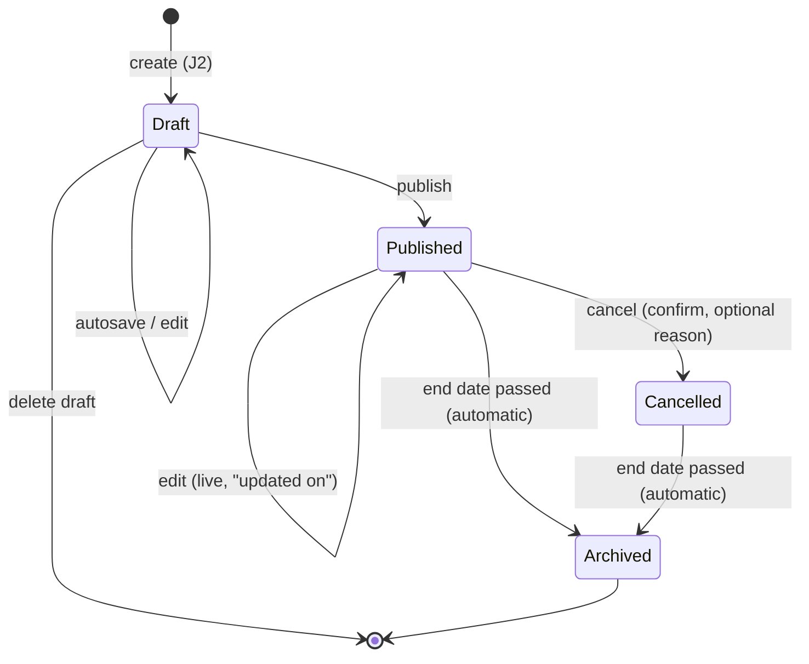

# HappiHub V1 — user journeys

Status: in progress (conception workshop 2). Each journey is validated separately by the
owner. Personas: [V1 personas](v1-personas.md). Scope: [V1 product framing](v1-product-framing.md).
Journeys drive the use-case diagrams, then wireframes (#249).

| # | Journey | Persona | Status |
| --- | --- | --- | --- |
| J1 | Discover HappiHub and sign up the association | Claire | To do |
| J2 | Create an event | Claire | **Validated 2026-10-15** |
| J3 | Preview, publish, then cancel or archive | Claire | **Validated 2026-10-15** |
| J4 | Invite a member and edit together | Claire, Malik | To do |
| J5 | Browse a public event page on mobile | Inès | **Validated 2026-10-15** |
| J6 | Connect the association website (API key) | Malik | To do |

## J2 — Create an event (Claire)

Decision: four-step wizard with a live poster preview (variant A4, score 4.7). Rejected:
three steps (overloads step 1), photo-only (blocks Claire without a photo), single form
(intimidating, preview lost on mobile), editable canvas (inaccessible, costly).
References considered: Luma (cover-first), Eventbrite (step wizard), Mobilizon
(association fields), Canva (styles); V1 keeps visual-first, few fields, guided input.

| Step | Fields (* required to publish) | Claire sees | Drop-off risk and mitigation |
| --- | --- | --- | --- |
| 1. What? | Title*, type (theatre, concert, exhibition, workshop…)*, short description* (300 chars), long description (optional) | Title appears large on the poster | Blank page: example titles and hooks per type |
| 2. When and where? | Start date/time*, end (optional), venue* (address suggestions), price (free, amount or pay-what-you-want) | Date and venue appear on the poster | Date/address formats: mobile-friendly picker, address suggestions |
| 3. Image | Upload a photo **or** pick one of 6 poster styles per type | Poster takes its colours | No photo: ready-made styles remove the blocker |
| 4. Preview and publish | None; summary and checklist | The public page as Inès will see it, mobile and desktop | Fear of publishing: "You can edit or cancel at any time" |

Always present: autosaved draft at each step ("Saved ✓"), progress bar, Back on every
step, resume where left off (Draft → Published lifecycle).

Playful touches, all accessible: poster building live, a sober celebration on first
publication (disabled under `prefers-reduced-motion`), warm microcopy ("Your show is taking
shape!"), poster styles per event type. None blocks keyboard or screen-reader use.

Success measures served: S3 (create and publish in < 5 minutes), S4, S5, S7.

Open points for the conception: address suggestion provider (must respect zero budget and
EU/GDPR), image limits and EXIF stripping (#62), poster style catalogue.

## J3 — Preview, publish, then cancel or archive (Claire)

Preview is J2 step 4. Three lifecycle decisions, each chosen against the alternatives:

| Decision | Choice (score) | Rejected and why |
| --- | --- | --- |
| D1 Edit a published event | Direct live edit on save (4.5): banner "visible immediately"; public "Updated on…" when date or venue changes; API exposes `updatedAt` | Draft of changes (3.5): two versions, risk Claire believes a fix is live. Edit forbidden (2.9): unpublishing empties partner sites |
| D2 Cancel | Page kept with a "Cancelled" banner and optional reason (4.8); explicit confirmation; final; API exposes `cancelled` | Delete page (3.4): shared links 404, visitors travel for nothing. Reversible cancel (4.1): rare, confusing public state; recreate instead |
| D3 Archive | Automatic after end date, or end of start day without end (4.8); page stays reachable as "Past event"; removed from agenda and the API "upcoming" listing | Manual (3.4): forgotten, cluttered agenda. Auto-delete (4.0): loses troupe history and links |

Only drafts can be deleted.

This replaces the current pending/approved/rejected moderation for V1 (no prior moderation;
reporting remains). Migration of existing events is a conception item.

## J5 — Browse a public event page on mobile (Inès)

Context: shared link, no account, phone, sometimes enlarged text. Goal: what, when, where
and how much in 10 seconds, then share.

| Decision | Choice (score) | Rejected and why |
| --- | --- | --- |
| D1 Top of page | Status banner first (cancelled / past), reduced J2 poster, then an "essentials" card (what, when, where, price) with actions (4.7) | Text-first (3.9): loses the visual appeal promised to Claire. Full-screen hero (3.2): essentials pushed below the fold, fails at 200 % text, slower |
| D2 Practical actions | Native share (Web Share API, copy-link fallback), add to calendar (.ics), "Directions" link opening the device's map app (4.8) | Embedded map + social buttons (3.0): third-party trackers, consent banner, slower. Share only (3.9): Inès retypes date and address |
| D3 Continue the visit | "Upcoming events from this troupe" list and a link to the association's public page (4.6) | Global recommendations (3.0): needs taxonomy and ranking (#126), out of V1. Nothing (3.6): dead end |

Also: Open Graph and basic structured metadata (title, image, date, venue) so shared links
preview well; no third-party scripts on public pages.

Implication for the conception: V1 needs a minimal **public association page** (name, short
description, upcoming and past events). To be covered with J1.
