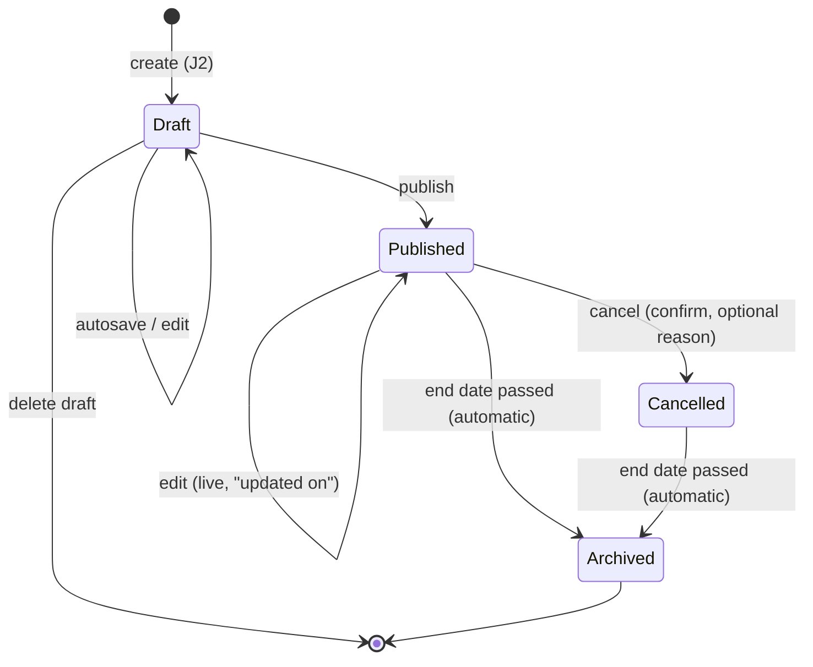

# HappiHub V1 — user journeys

Status: complete — all six journeys validated on 2026-10-15 (conception workshop 2). Each journey is validated separately by the
owner. Personas: [V1 personas](v1-personas.md). Scope: [V1 product framing](v1-product-framing.md).
Journeys drive the use-case diagrams, then wireframes (#249).

| # | Journey | Persona | Status |
| --- | --- | --- | --- |
| J1 | Discover HappiHub and sign up the association | Claire | **Validated 2026-10-15** |
| J2 | Create an event | Claire | **Validated 2026-10-15** |
| J3 | Preview, publish, then cancel or archive | Claire | **Validated 2026-10-15** |
| J4 | Invite a member and edit together | Claire, Malik | **Validated 2026-10-15** |
| J5 | Browse a public event page on mobile | Inès | **Validated 2026-10-15** |
| J6 | Connect the association website (API key) | Malik | **Validated 2026-10-15** |

## J2 — Create an event (Claire)

Decision: four-step wizard with a live poster preview (variant A4, score 4.7). Rejected:
three steps (overloads step 1), photo-only (blocks Claire without a photo), single form
(intimidating, preview lost on mobile), editable canvas (inaccessible, costly).
References considered: Luma (cover-first), Eventbrite (step wizard), Mobilizon
(association fields), Canva (styles); V1 keeps visual-first, few fields, guided input.

| Step | Fields (* required to publish) | Claire sees | Drop-off risk and mitigation |
| --- | --- | --- | --- |
| 1. What? | Title*, type (theatre, concert, exhibition, workshop…)*, short description* (300 chars), long description (optional) | Title appears large on the poster | Blank page: example titles and hooks per type |
| 2. When and where? | Start date/time*, end (optional), venue* (address suggestions), price (free, amount or pay-what-you-want) | Date and venue appear on the poster | Date/address formats: mobile-friendly picker, address suggestions |
| 3. Image | Upload a photo **or** pick one of 6 poster styles per type | Poster takes its colours | No photo: ready-made styles remove the blocker |
| 4. Preview and publish | None; summary and checklist | The public page as Inès will see it, mobile and desktop | Fear of publishing: "You can edit or cancel at any time" |

Always present: autosaved draft at each step ("Saved ✓"), progress bar, Back on every
step, resume where left off (Draft → Published lifecycle).

Playful touches, all accessible: poster building live, a sober celebration on first
publication (disabled under `prefers-reduced-motion`), warm microcopy ("Your show is taking
shape!"), poster styles per event type. None blocks keyboard or screen-reader use.

Success measures served: S3 (create and publish in < 5 minutes), S4, S5, S7.

Open points for the conception: address suggestion provider (must respect zero budget and
EU/GDPR), image limits and EXIF stripping (#62), poster style catalogue.

Idea to debrief later (owner, 2026-10-15, not yet a decision): suggest seasonal poster
backgrounds from the event date in step 3 (e.g. Halloween, Christmas). To assess: V1 or
later, catalogue size and licensing, date windows, cultural neutrality, accessibility of
backgrounds behind text.

## J3 — Preview, publish, then cancel or archive (Claire)

Preview is J2 step 4. Three lifecycle decisions, each chosen against the alternatives:

| Decision | Choice (score) | Rejected and why |
| --- | --- | --- |
| D1 Edit a published event | Direct live edit on save (4.5): banner "visible immediately"; public "Updated on…" when date or venue changes; API exposes `updatedAt` | Draft of changes (3.5): two versions, risk Claire believes a fix is live. Edit forbidden (2.9): unpublishing empties partner sites |
| D2 Cancel | Page kept with a "Cancelled" banner and optional reason (4.8); explicit confirmation; final; API exposes `cancelled` | Delete page (3.4): shared links 404, visitors travel for nothing. Reversible cancel (4.1): rare, confusing public state; recreate instead |
| D3 Archive | Automatic after end date, or end of start day without end (4.8); page stays reachable as "Past event"; removed from agenda and the API "upcoming" listing | Manual (3.4): forgotten, cluttered agenda. Auto-delete (4.0): loses troupe history and links |

Only drafts can be deleted.

This replaces the current pending/approved/rejected moderation for V1 (no prior moderation;
reporting remains). Migration of existing events is a conception item.

## J5 — Browse a public event page on mobile (Inès)

Context: shared link, no account, phone, sometimes enlarged text. Goal: what, when, where
and how much in 10 seconds, then share.

| Decision | Choice (score) | Rejected and why |
| --- | --- | --- |
| D1 Top of page | Status banner first (cancelled / past), reduced J2 poster, then an "essentials" card (what, when, where, price) with actions (4.7) | Text-first (3.9): loses the visual appeal promised to Claire. Full-screen hero (3.2): essentials pushed below the fold, fails at 200 % text, slower |
| D2 Practical actions | Native share (Web Share API, copy-link fallback), add to calendar (.ics), "Directions" link opening the device's map app (4.8) | Embedded map + social buttons (3.0): third-party trackers, consent banner, slower. Share only (3.9): Inès retypes date and address |
| D3 Continue the visit | "Upcoming events from this troupe" list and a link to the association's public page (4.6) | Global recommendations (3.0): needs taxonomy and ranking (#126), out of V1. Nothing (3.6): dead end |

Also: Open Graph and basic structured metadata (title, image, date, venue) so shared links
preview well; no third-party scripts on public pages.

Implication for the conception: V1 needs a minimal **public association page** (name, short
description, upcoming and past events). To be covered with J1.

## J1 — Discover HappiHub and sign up the association (Claire)

Goal: from first click to first poster in under 5 minutes overall.

| Decision | Choice (score) | Rejected and why |
| --- | --- | --- |
| D1 Sign-up flow | One screen: email, password, association name, then straight into J2 "Create your first event" (4.7) | Account first, association later (3.6): empty dashboard, Claire must guess. Verified association (RNA/SIRET) first (2.6): number rarely at hand, near-certain drop-off |
| D2 Authentication | Email + password on the existing cookie sessions; drafts allowed immediately, verified email required before first publication (4.4) | Magic link (3.9): opening mail at every sign-in, redoes the secured auth. Google/Facebook (2.8): third-party dependency, GDPR, not every volunteer has an account |
| D3 Abuse guard (no prior moderation) | Verified email to publish, creation quotas and rate limits, "Report" button handled by the owner (4.5) | Mandatory RNA (3.2): excludes informal collectives, real check costly. Manual approval (3.0): depends on owner availability, contradicts J3 |
| D4 Public association page | Name, optional logo, city only, short presentation, website link, optional generic contact email (`mailto:`), upcoming then 6 latest past events with "See more", readable URL slug (4.5) | Same without contact (4.4): Inès cannot ask an access question. Rich page (2.9): mail relay, spam, members exposed. No page (3.8): breaks J5 D3 |

Privacy rules: never display member names or personal emails; city only (the registered
address is often a member's home); logos follow the event image rules (#62).

Edge cases: interrupted sign-up resumes without re-entry; if the troupe already exists,
sign-up suggests asking for an invitation (J4) to avoid duplicate associations; slug
collisions need a rule in the conception.

New dependency to study in the conception: a transactional email provider (verification,
password reset, invitations) compatible with zero budget and EU hosting.

## J4 — Invite a member and edit together (Claire, Malik)

All members have the same rights (framing). J4 keeps that simple without making it unsafe.

| Decision | Choice (score) | Rejected and why |
| --- | --- | --- |
| D1 Invite | Invitation bound to the invitee's email, sent by mail **and** copyable for WhatsApp; single use, expires after 7 days, revocable from "Pending invitations"; inviter needs a verified email; quota (e.g. 10 per day per association) (4.5). Wrong-address acceptance is refused with a masked hint | Single-use link for any email (4.4): a link leaked in a group chat admits the first clicker with full rights. Open link (3.6). Direct add of an existing account (3.6): Malik signs up alone, duplicate troupe risk |
| D2 Concurrent edits | Optimistic versioning on every save, autosave included; automatic field-level merge when different fields changed; prompt only when the same field changed ("Malik also changed the title: keep yours or his?") (4.6) | Whole-event mine/theirs (3.8): loses the other's fields, frequent prompts with autosave. Lock (3.0): ghost locks. Real-time (3.7): too costly for V1 |
| D3 Remove or leave | Any member may remove another or leave; never the last member; removal immediate, sessions revoked; removed member is emailed with an "I dispute this" link creating a report the owner can act on (reinstate); action logged (4.5) | Delayed 48 h removal (4.2): ex-volunteer keeps access, scheduled jobs. No recourse (4.0): takeover unrecoverable. Creator-only (2.8): hidden role contrary to framing |
| D4 Traceability | "Created by" and "Last edited by … ago" on events; activity log of sensitive actions (create, publish, cancel event; invite, join, remove, leave member), visible to members only, kept 12 months, no IP address (4.5) | Author/editor only (4.3): no evidence for D3 disputes. Full version history (3.0): study #114, out of V1 |

## J6 — Connect the association website (Malik)

Framing: read API keyed per organizer, server to server. Goal: "the website updated itself".

| Decision | Choice (score) | Rejected and why |
| --- | --- | --- |
| D1 Integration | Server-side JSON REST API with an association key, plus copy-ready snippets (WordPress/PHP, Node, curl) pre-filled with Malik's key (4.2) | Embeddable widget without key in addition (3.8): a second product to design and make accessible, V2. Widget only (3.9): contradicts the framing, loses S2 |
| D2 Key management | Several named keys per association (e.g. "WordPress site"), secret shown once and stored hashed, revocable, `lastUsedAt`, creation/revocation in the J4 activity log; any member can manage keys (4.5) | Single regenerable key (4.0): rotation breaks the site. OAuth client credentials (2.5): oversized for public event reads |
| D3 API content | Read-only `/v1`: upcoming published events, cancelled ones included with their status, event detail, past events on request, pagination, `updatedSince`, same fields as the J5 public page, rate limits (4.6) | Webhooks (3.7): delivery queue, retries, signatures, V2. Drafts exposed (2.8): leak of unpublished content |

Security rules: key-authenticated routes reject browser cross-origin calls (no CORS) and are
documented as server-side only; a key only ever reads its own association's published,
cancelled or archived events; never drafts, member data or emails.

Success measure served: S2 (`lastUsedAt`), S6.
